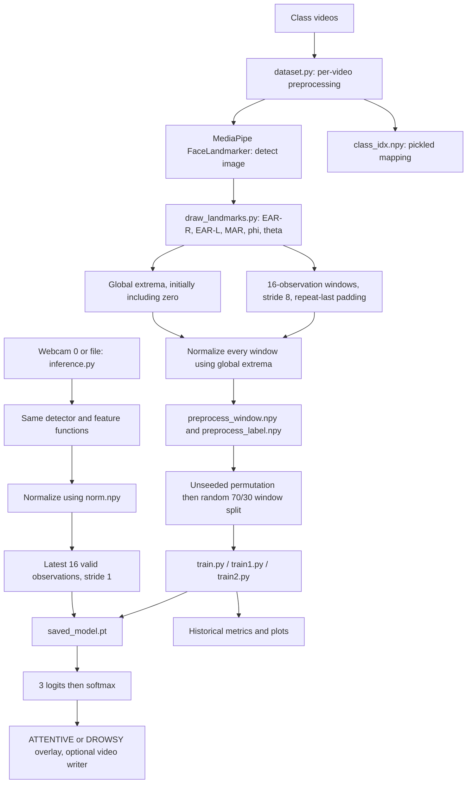
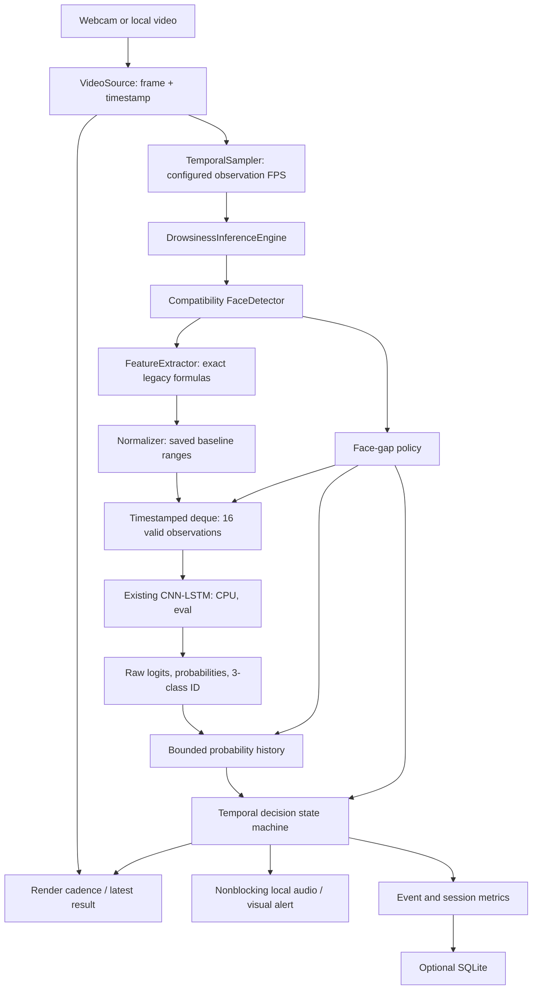

# Current architecture and implementation plan

Audit date: 2026-09-26. Scope: **Phase 1 only**. No application, training,
preprocessing, checkpoint, or configuration changes were made during this audit.
The only new repository file is this report. Later phases below are proposals,
not completed work.

## 1. Findings and evidence limits

The repository contains a genuine temporal feature-based CNN-LSTM, two distinct
compatible checkpoint archives, three nearly duplicated training scripts, and
five inference variants. `inference.py` is the README entry point and the best
reference for future inference parity. It already supports webcam 0 and a local
video through the same loop. The CNN convolves along time over five handcrafted
features; it does not operate on image pixels or perform spatial image encoding.

The main correctness risks are overlapping-window evaluation leakage,
normalization fitted before splitting, discarded video/subject provenance,
inconsistent legacy sequence indexing, unlimited face-gap tolerance, and
preprocessing quirks that are part of the existing checkpoint contract.

Audit coverage:

- Read all 16 root Python files, both complete notebook code cells and saved
  outputs, `config.ini`, `requirements.txt`, `Readme.MD`, both Arduino sources,
  and all three `.vscode` JSON files.
- Inspected NumPy shapes, dtypes, extrema, counts, overlap, and finite values.
- Disassembled `class_idx.npy` as pickle without executing it.
- Inspected both checkpoint ZIP archives using a restricted metadata reader
  that substitutes tensor/storage descriptors; inspected their float32 storage
  arrays without importing PyTorch or running model code.
- Inspected the MediaPipe task archive contents and artifact SHA-256 hashes.
- Read AVI headers for all 180 class videos and `model_output.avi`. Decoded the
  first embedded MJPEG image from one video per class using Pillow. This does
  **not** establish full-video OpenCV decoding or detector correctness.
- Visually inspected all six result/training plots and representative first and
  last images from the 138-image mesh demonstration directory.
- Checked repository status and history. No applicable `AGENTS.md` was found in
  the workspace or checked ancestor directories. No test suite exists.

Runtime limitations: `.venv/pyvenv.cfg` points to Python 3.14.2; its launcher
fails with “Access is denied,” and its site-packages inventory contains only
pip. The available bundled Python 3.12.14 has NumPy 2.3.5 and Pillow, but lacks
PyTorch, MediaPipe, OpenCV, scikit-learn, matplotlib, tqdm, pyserial, and pytest.
No dependencies were installed. No webcam, live GUI, sound, full inference,
numerical logits parity, training, evaluation, or CPU benchmark was run.

Four modified tracked `.pyc` files predate this audit and remain untouched.
All audit Python commands used `-B` to avoid writing bytecode. A read-only probe
initially hit console encoding trouble; the video/checkpoint portion was rerun
successfully with safe text output. This was an audit-tool issue, not a model
failure.

## 2. Current architecture



Training and inference share detector construction and feature formulas but
duplicate normalization, buffering, prediction interpretation, and video logic.
The historical alternatives have independent top-level loops and alert policies.

## 3. Exact model contract and tensor data flow

Sources: `model.py:6-71`, `dataset.py:101-151`, `inference.py:130-173`.

- Feature order is **EAR-R, EAR-L, MAR, phi, theta**.
- One valid observation is `(5,)`; a window is `(5, 16)` in chronological order.
- Model input is float32 **`(batch, features, observations) = (B, 5, 16)`**.
  `(B, 16, 5)` is incorrect at the Conv1d input.
- The cached training array is float64 `(3165, 5, 16)`; training converts it to
  float32. Inference performs feature arithmetic in NumPy before conversion.
- Model output is unnormalized **logits** `(B, 3)`, despite the misleading
  `return x  # Output probabilities` comment. Softmax is applied by callers.
- The recurrent hidden state is freshly initialized for each window; it is not
  carried between predictions.

| Layer / operation | Output for N=16 | Parameters |
| --- | --- | ---: |
| Input | `(B, 5, 16)` | 0 |
| Conv1d 5→32, kernel 3, stride 1, no padding | `(B, 32, 14)` | 512 |
| ReLU | `(B, 32, 14)` | 0 |
| Conv1d 32→64, kernel 3, stride 1, no padding | `(B, 64, 12)` | 6,208 |
| ReLU | `(B, 64, 12)` | 0 |
| MaxPool1d kernel/stride 2 | `(B, 64, 6)` | 0 |
| CNN dropout 0.25 | `(B, 64, 6)` | 0 |
| Permute `(0, 2, 1)` | `(B, 6, 64)` | 0 |
| LSTM layer 0, input 64, hidden 128 | `(B, 6, 128)` | 99,328 |
| LSTM layer 1, input/hidden 128 | `(B, 6, 128)` | 132,096 |
| LSTM hidden/cell, each | `(2, B, 128)` | included above |
| Output dropout 0.25 | `(B, 6, 128)` | 0 |
| Select last recurrent output | `(B, 128)` | 0 |
| Linear 128→64 and ReLU | `(B, 64)` | 8,256 |
| Linear 64→3 | `(B, 3)` | 195 |
| Caller softmax over classes | `(B, 3)` | 0 |

Total: **246,595 parameters**, verified against both serialized checkpoint
metadata and float storage lengths. Float32 parameter payload is **986,380
bytes**; each checkpoint file is **991,798 bytes**. These are measured artifact
sizes, not RAM usage or runtime measurements. No bidirectionality or internal
LSTM dropout is configured; dropout is an explicit layer after the LSTM.

Weight initialization uses Kaiming for Conv1d and LSTM input weights, orthogonal
LSTM recurrent weights, Xavier for dense weights, and zero biases. Inference
loads weights after initialization and calls `eval()`.

For generic N, the two convolutions leave `N-4` steps and pooling leaves
`floor((N-4)/2)` steps. Thus 8/16/24/32 give 2/6/10/14 LSTM steps without changing
parameter shapes. This is a structural deduction, **not runtime verification
or evidence that the 16-observation checkpoint is trained for other lengths**.
Keep production N=16; retrain and evaluate each alternative later.

## 4. Preprocessing compatibility contract

### Detector and color

`dataset.get_detector()` constructs one FaceLandmarker with one face, blendshape
output enabled, and transformation matrices enabled. No running mode is
explicitly set; it uses `detect(image)`, with no video timestamps or tracking
API. The extra outputs are never consumed by feature extraction.

Both training and every inference script pass the raw OpenCV frame directly to
`mp.Image(image_format=mp.ImageFormat.SRGB, data=frame)`. There is **no BGR→RGB
conversion**. Preserve this exact path in the initial parity baseline. Adding a
conversion or changing detector mode/options must be a separately validated
experiment because landmarks and downstream features can change.

The task archive is 3,758,596 bytes and includes:

| Member | Bytes |
| --- | ---: |
| `face_detector.tflite` | 229,746 |
| `face_landmarks_detector.tflite` | 2,553,590 |
| `geometry_pipeline_metadata_landmarks.binarypb` | 19,376 |
| `face_blendshapes.tflite` | 955,312 |

### EAR and MAR

Only landmark x/y are used; z is discarded. Coordinates stay normalized rather
than being scaled by image width/height. Distances are NumPy Euclidean distances
in this normalized coordinate space. Neither formula guards zero horizontal
distance or nonfinite input.

`ratio = (distance(p0,p1) + distance(p2,p3) + distance(p4,p5)) /
(3 * distance(p6,p7))` applies to all three ratios:

| Feature | Landmark indices in exact order |
| --- | --- |
| EAR-R | `[160,144,159,145,158,153,33,133]` |
| EAR-L | `[385,380,386,374,387,373,362,263]` |
| MAR | `[81,178,13,14,311,402,78,308]` |

Changing to pixel coordinates would also change these ratios on nonsquare
frames. Preserve the existing geometry before experimental corrections.

### Head pose

`draw_landmarks.py:54-101` uses fixed float64 3D points:

```text
(0,0,0), (0,-330,-65), (-225,170,-135),
(225,170,-135), (-150,-150,-125), (150,-150,-125)
```

The corresponding submitted 2D landmark order is `[10,33,263,152,61,291]`.
It does not match the semantic point order described in the 3D comments
(nose, chin, left eye, right eye, left mouth, right mouth). In addition, the 2D
coordinates remain normalized while the camera matrix uses pixel dimensions:
`fx=fy=image_width`, `cx=width/2`, `cy=height/2`; distortion is `(4,1)` zeros.
`solvePnP()` is called with default flags and its success value is ignored.

The code computes Rodrigues rotation, concatenates translation to form a 3×4
projection matrix, decomposes it, and calls `np.degrees(euler_angles)` again.
OpenCV documents the decomposition's Euler angles as already in degrees;
the extra conversion scales them by approximately 57.2958. [OpenCV API
documentation](https://docs.opencv.org/4.13.0/d9/d0c/group__calib3d.html).

`phi = euler_angles[0]` and `theta = euler_angles[1]`, with callers extracting
`phi[0]`/`theta[0]`. Comments describing these as left/right and up/down rotations
do not establish physically calibrated yaw/pitch semantics. Display them as
legacy pose features until corrected geometry is evaluated with retraining.

**Do not silently repair point order, coordinate units, angle scaling, color,
or ratio formulas while refactoring.** The saved normalization and model may
depend on them. Invalid calculations should eventually yield an explicit invalid
observation rather than fabricated replacement features; that policy change
needs its own tests and documented parity exception.

### Normalization

Training initializes each min/max pair to `[0,0]`, updates them over every video,
constructs windows, then normalizes the entire dataset before splitting.
Inference uses the saved ranges with the same formula:

`normalized[f] = (raw[f] - min[f]) / (max[f] - min[f])`.

No clipping, epsilon, calibration, or denominator validation exists. The saved
range array is finite float64 `(5,2)`:

| Feature | Saved minimum | Saved maximum |
| --- | ---: | ---: |
| EAR-R | 0 | 0.9855153534244486 |
| EAR-L | 0 | 0.8781455415684587 |
| MAR | 0 | 2.076403213814714 |
| phi | -10309.39907651324 | 10310.932575979636 |
| theta | -4683.9991524140205 | 5092.136940665999 |

All denominators are positive in this artifact. Cached normalized feature ranges
are EAR-R `[0.00213443446,1]`, EAR-L `[0.00476367470,1]`, MAR
`[0.00074519060,1]`, phi `[0,1]`, theta `[0,1]`. Future observations may exceed
these bounds; clipping would alter existing model semantics.

## 5. Temporal windows and time scale

Training (`dataset.py:21-45`) processes each video independently and collects
only observations with detected landmarks. Missing frames are skipped without
timestamps, so valid observations on either side of a long gap become adjacent.

- Window length 16; overlap 8; step `window_size-overlap = 8` observations.
- Starts are every multiple of 8 less than the number of valid observations.
- Every incomplete tail is padded by repeating the last observation. This can
  produce more than one padded tail window. A video with 17 valid observations
  produces starts 0, 8, and 16; the last window repeats observation 17 sixteen
  times. The standalone `create_windows` function was exercised read-only to
  confirm this behavior.
- Empty/no-face videos fail earlier at `min(empty_feature_list)`. There is no
  window/overlap validation or record of source frames/times.

Main inference (`inference.py`) correctly appends the latest valid observation,
trims to 16, and predicts after 16 valid observations. Thereafter stride is 1:
observations 1–16, 2–17, 3–18. Warm-up displays “Loading...”. This hardcodes 16
rather than reading `window_size`. No padding is used in live warm-up.

The four alternatives use `all_features[:,cnt]`, incrementing `cnt` **only
after** the buffer is full. A read-only symbolic reproduction confirms:

| Observation received | Actual legacy input buffer |
| --- | --- |
| 16 | observation 1 repeated 16 times |
| 17 | observation 1 repeated 15 times, then observation 2 |
| 31 | observations 1–16 |
| 32 | observations 2–17 |

After warm-up these buffers lag the latest observation by 15 valid observations.
Do not choose an affected script as the canonical temporal baseline.

All 180 included training-video headers report **20 FPS**, MJPG, 640×480. The
capture notebooks write a fixed 20 FPS but capture as quickly as the camera
loop permits, without pacing. Thus encoded cadence is established; actual
wall-clock capture cadence and exact checkpoint training provenance are not.

At 20 observations/second, 16 observations span **0.75 seconds from first to
last timestamp**, or **0.8 seconds of nominal observation intervals**. Training
stride 8 represents 0.4 seconds nominally; main inference stride 1 represents
0.05 seconds. Missing detections can extend actual window duration.

No existing inference script has a model sampler. Webcam cadence depends on
camera and loop throughput; recorded videos run as fast as processing and
`waitKey(1)` permit. Writer FPS metadata does not control model sampling.
`inference2.py` uses wall-clock time even for any manually substituted video.

Proposal: retain a no-resampling compatibility mode for parity; then introduce
timestamp-aware sampling with **20 FPS as an evidence-based initial candidate**.
Use monotonic acquisition timestamps for webcam and media timestamps for files,
with a documented fallback when file timestamps are unavailable. Do not
duplicate observations to conceal missed deadlines. Validate actual cadence,
gap resets, frame drops, and alert responsiveness separately from tensor parity.

## 6. Artifacts, labels, and dataset inventory

`config.ini` selects `./saved_model.pt` for all inference scripts. Both
checkpoints contain compatible float32 CPU state dictionaries with 16 parameter
tensors and finite values. Their tensor storage contents differ. Neither stores
configuration, class labels, split IDs, sampling rate, dataset hashes, run seed,
or measured accuracy. The name `saved_model_0.95.pt` is not metric evidence.

`class_idx.npy` is **a pickle, not a NumPy .npy array**. Training reads/writes it
using `pickle`; inference never reads it and hardcodes numeric meanings. Opcode
inspection confirms the current mapping:

| ID | Saved class | Raw videos | Header frame count | Cached windows | Window share |
| --- | --- | ---: | ---: | ---: | ---: |
| 0 | Normal | 60 | 8,397 | 1,067 | 33.71% |
| 1 | Yawning | 60 | 8,347 | 1,044 | 32.99% |
| 2 | Eye Close | 60 | 8,316 | 1,054 | 33.30% |
| Total | | 180 | 25,060 | 3,165 | 100% |

The videos total 756,737,154 bytes. Header frame-count ranges are Normal
131–141, Yawning 135–141, Eye Close 116–141. Approximate encoded duration is
1,253 seconds total. This is header metadata, not a complete decode count.

The cached labels are int64 `(3165,)`, arranged in three contiguous class runs.
The window array is finite float64 `(3165,5,16)`. Raw and cached class counts
are nearly balanced; automatic balancing is not justified by these counts.
There is no implemented weighting or weighted sampling.

Assuming every header frame yielded a valid observation, the current window
formula would produce 1,077/1,077/1,071 windows (3,225 total). The 3,165 cached
windows differ, plausibly because of missing detections or dataset provenance;
the difference cannot establish its cause without regenerating features.

Of 3,164 adjacent cached-window pairs, **2,985** have an exact eight-observation
overlap. Splitting at the remaining boundaries yields **180 overlap runs,
60 per class**, consistent with per-video preprocessing. This is useful
reconstruction evidence, but filenames and identity cannot be proved from
overlap alone. There are 393 windows with identical final two feature columns;
this is consistent with padding or stationary features, not a count of padding
events. Do not assign subject IDs from directory numbering or appearance.

The configured raw dataset path `../Customdata` does not exist in this
workspace. Class folders are instead in the repository root. Regeneration must
use an explicit class-directory manifest, not enumerate the entire repository
as classes. The current `os.listdir()` mapping is unsorted and unfiltered; a
different directory order would silently change numeric class semantics.

Artifact identity for future parity fixtures:

| Artifact | SHA-256 |
| --- | --- |
| `saved_model.pt` | `162426d6292a87162188b70d7bac6704e5bf217f8ff1fe5eaafc41085aa0c551` |
| `saved_model_0.95.pt` | `9380b6f71bfe29776e08a99ff00f25e507270d1105d1b6672cceceec567be521` |
| `norm.npy` | `54b2a1fc66cc8eab3b68ba2b5fe081558aabc6e48c79f752d1d49026494e1900` |
| `class_idx.npy` | `4f06c199cfdb8031a6caf92501e19a073dcf08399c4661c3f9336c0fb81818b2` |
| `preprocess_window.npy` | `7c2dfd1ea6ec3762a70f93fb643b5331d6d697fd6bf71d2e330b45f17117c887` |
| `preprocess_label.npy` | `ad97dd66d61cc4bcdfc1879fdee6bf71813620787adea04599f2a8fdbf11db27` |
| `face_landmarker.task` | `64184e229b263107bc2b804c6625db1341ff2bb731874b0bcc2fe6544e0bc9ff` |

## 7. Training and evaluation audit

All training scripts run at import time and use the following pipeline:

1. Parse config, initialize CNN-LSTM, load cached arrays and pickled mapping
   (`use_existing_preprocessesd_data=True`), or preprocess and overwrite caches.
2. Apply an unseeded NumPy permutation, convert inputs to float32 and labels to
   long, then `train_test_split(test_size=0.30, random_state=42)` on windows.
   The seeded split is not reproducible because the preceding permutation and
   model/DataLoader random state are unseeded. No stratification or group IDs.
3. Train 150 epochs, batch 64, shuffled DataLoader, CPU tensors, Adam initial
   learning rate 0.001. CrossEntropyLoss is reduced over the batch; the code
   applies `(1-exp(-batch_loss))**2 * batch_loss` with alpha=1, gamma=2. This
   is a batch-level focal-like transform, not a per-example focal loss.
4. OneCycleLR uses linear annealing and pct_start=0.3. `train.py`/`train2.py`
   use max_lr=0.01; `train1.py` uses 0.001.
5. Save the final state dict to `saved_model.pt`; plot training loss, training
   accuracy, and LR. No separate validation set, early stopping, best-validation
   checkpoint, balancing, or persisted split manifest.
6. Evaluate once on the entire test tensor and write per-class metrics,
   classification report, and confusion matrix plots.

`train.py` and `train1.py` fail to switch the model to `eval()` before testing,
so dropout remains active; they also do not disable autograd. `train2.py` trains
and saves one model, but evaluates a newly loaded **different checkpoint**,
`saved_model_0.95.pt`, in eval mode on the newly randomized split. None of the
three can establish clean held-out performance for the selected production
checkpoint. Loss accumulation also retains tensor graph references rather
than accumulating scalar `.item()` values.

Leakage and limitations:

- Window-level splitting permits overlapping windows from the same video on
  both sides of the split. Exact cached overlaps verify the underlying risk;
  the historical split membership was not saved, so its exact leakage extent
  cannot be recovered.
- Even nonoverlapping windows from a shared video are correlated. Driver-level
  separation is absent; subject IDs and recording-session IDs are unavailable.
- Normalization uses all videos before splitting, including held-out values.
- Whole-video action labels also apply to transition frames and padded tails;
  there are no frame/event onset annotations for alert-policy validation.
- A new group split over the old checkpoint's training corpus cannot be called
  an independent test of that checkpoint: its historical exposure is unknown.
  A trustworthy result requires retraining on a fixed clean split or collecting
  a genuinely unseen external test set.

Historical plots are artifacts, not reproduced results. The saved confusion
matrix reads `[[309,4,1],[13,303,2],[0,2,316]]`, supports 314/318/318 and total
950. Arithmetic from those displayed counts gives **97.6842% accuracy** and
**0.976785 macro F1**, whereas `Readme.MD` claims 97.83%. The metric heatmap
matches the matrix; the separate line graph displays different approximate
values and has no generation code. No plot has checkpoint/split provenance.
Do not publish these as new or subject/video-independent achievements.

Proposed evaluation: explicit source manifest, subject groups when defensible
IDs exist (otherwise video groups), fixed train/validation/test group assignment
**before window generation**, train-only normalization for retrained models,
no shared source sequence across splits, and immutable split hashes/seeds.
Report accuracy, macro precision/recall/F1, per-class metrics/support, confusion
matrix CSV/PNG, class counts, and provenance. Keep legacy-normalized checkpoint
characterization separate from new leakage-safe retraining.

## 8. Inference variants, video handling, and alerts

| Script | Acquisition / output | Temporal and decision behavior | Major limitations |
| --- | --- | --- | --- |
| `inference.py` | CLI `--source 0` or existing path; optional `--save`, `--output` | Correct latest-observation stride 1; eval + no_grad; confidence shown; IDs 1/2 both displayed DROWSY | No smoothing, timing, gap reset, audio, event metrics, reusable engine |
| `inference1.py` | Hardcoded webcam 0; automatic writer | Legacy indexing bug; display only after last 5 labels agree, beginning at prediction 6 | Autograd active, console/tensor copies, broad face exception, no timing |
| `inference2.py` | Hardcoded webcam 0; automatic writer | Same indexing bug and 5-label agreement; shows current class immediately during first 5 seconds, then briefly inserts Normal and restarts timer | Timer is reversed relative to persistence intent; no real cooldown |
| `inference4.py` | Hardcoded webcam 0; automatic writer | Same indexing bug; last 3 labels must agree | Autograd active, repeated softmax/copies and shape printing |
| `inference_hw.py` | Hardcoded webcam 0; writer created but never written | Same indexing bug; attempts immediate serial writes for IDs 0/1 | `arduino` undefined, ID 2 unhandled, serial cleanup undefined |

The main script recognizes **only string `'0'`** as a camera; `'1'` is treated as
a filename. Missing paths and sources that fail to open are reported, but model
loading occurs first and can fail before source validation. Read failure ends
the loop without distinguishing EOF, decode error, or camera disconnection.

`--save` with default `model_output.avi`, or a bare output filename, calls
`os.makedirs('')` and fails. Writer initialization is not checked. The main
script releases capture/writer on normal exit but lacks exception-safe cleanup
and explicit detector closure; alternatives do not release their writers.
All paths are relative to the working directory. No explicit CPU map_location
is given, although both current checkpoint archives record CPU storages.
Normalization is loaded twice in the main script because its debug f-string
evaluates `np.load` even with DEBUG=False.

All variants preserve temporal buffers across arbitrary face loss. Main inference
renders a no-face overlay; alternatives immediately `continue`, skipping GUI
updates, key handling, and output on missing-face frames. None stores timestamps
or clears smoothing/persistence on gaps.

No working local audio manager exists. `arduino_sample.py` prints placeholders;
`send_arduino.py` contains comments only. `sample_arduino.py` has a confirmed
line-7 indentation SyntaxError and references undefined `send_signal`.
The `.ino` file begins with invalid `# Repo refresh...`, expects `Y/E/N`, and
uses a blocking buzzer loop. `arduino_code.cpp` expects newline-terminated
`DROWSY/ATTENTIVE`, while `inference_hw.py` tries `0/1`; these protocols disagree.
The C++ library's display API has not been compiled/verified. Hardware code
should remain isolated from the required local OpenCV/audio application.

No existing state machine, cooldown, duration counters, event segmentation,
SQLite logger, or PERCLOS implementation is present. The README's hardware
claims are not supported by a runnable integrated path in this checkout.

## 9. Performance risks requiring measurement

There are no baseline CPU benchmarks, timing logs, sustained FPS results, or
hardware records. The following are code-based candidates, not measured speedups:

- Five feature histories grow for the entire session. Every valid observation
  calls `vstack` on all accumulated history, making cumulative copying O(T²).
  The window list alone is bounded; retaining column views can also retain the
  larger historical NumPy allocations behind recent buffer entries.
- Legacy variants build autograd graphs, make redundant tensor copies, evaluate
  softmax repeatedly, and print within the frame loop. The main script already
  has eval + no_grad, so it must not be credited as a new optimization later.
- Detector processing occurs on every acquired frame; blendshapes/transforms
  are enabled but unused. Detector option/mode changes require landmark parity.
- Blocking acquisition, rendering, optional encoding, and inference share one
  loop. None measures capture, detector, feature, normalization, model,
  decision, render, or total latency independently.
- No CPU thread settings, bounded timing statistics, target sampling cadence,
  deadline accounting, or startup-versus-steady-state distinction.
- Model initialization performs orthogonal initialization even before loading
  a checkpoint; startup cost must be separated from steady-state timing.

First baseline the canonical original path on fixed frames. Then change one
meaningful optimization per comparison, retaining improvements only after
numerical parity and repeated measurements. Report mean/P50/P95, sample counts,
warm-up, source FPS/resolution, capture/render/model FPS separately, memory,
CPU/thread/software/hardware context, and uncertainty. Compute improvements from
like-for-like measurements; fewer sampled frames alone is not a model speedup.

## 10. Proposed local architecture

Use a single small package named `driver_monitor` to avoid a top-level
`inference/` package colliding with existing `inference.py`. Keep `model.py` and
the baseline checkpoints intact. Main entry point is local `main.py`;
`inference.py` can later become a compatibility CLI wrapper after fixtures exist.
No server, web transport, browser hosting, Docker, or cloud infrastructure.



Engine responsibilities: one-time validated asset loading and detector creation;
compatibility feature extraction; normalized timestamped buffer; raw model
inference; bounded history; structured result. Keep model execution separate
from policy classes. Results include timestamp, face/observation validity,
raw class, raw probabilities, smoothed probabilities, confidence, feature values,
sequence fill, warm-up, state, gap reset, alert/event transitions, and individual
stage/pipeline timings. Both source modes call this exact engine.

Maintain two explicitly distinguished behaviors:

1. **Compatibility baseline:** exact original feature distribution and original
   canonical observation sequence; this establishes numerical parity.
2. **Runtime policy:** configured sampler, long-gap reset, smoothing, persistence,
   UI/events/audio; these intentionally change observation selection and derived
   states, but not raw inference for an identical supplied sequence.

Face loss immediately yields NO_FACE and cannot accumulate alert evidence.
Short gaps may retain features within a configured maximum; long gaps clear
buffer, smoothing, and relevant persistence, and require warm-up on return.
Timestamp checks must also catch gaps between valid observations even when no
explicit missing-face frame was processed. Avoid crediting unobserved time as
continuous eye closure or counting it as a classified Normal interval.

Retain raw Normal/Yawning/Eye Close independently of derived states. Suggested
policy states are WARMING_UP, NO_FACE, ATTENTIVE, FATIGUE, SUSPECTED_DROWSY,
DROWSY, ALERT. Yawning marks a fatigue event; confident persistent eye closure
drives suspected/drowsy/alert transitions. Choose smoothing and persistence on
validation clips, with engineering defaults explicitly labeled unvalidated.
Record event start/active/end once per event, monotonic durations, cooldown and
alert count; name an eye-close observation fraction descriptively rather than
calling it medically validated PERCLOS. Sound must run off the video loop and
must not restart on every prediction. SQLite stays optional and stores events
and aggregates, not raw frames.

Central configuration will retain asset paths and introduce sequence length,
target model FPS, maximum face gap, history length, confidence/vote agreement,
eye-close persistence, alert cooldown, audio/SQLite/debug toggles, and CPU thread
settings. Validate dimensions, mapping, finite ranges, threshold bounds, paths,
and timestamps. Production sequence length stays 16 until retraining evidence.

## 11. Exact planned files and phase boundaries

Only `CURRENT_ARCHITECTURE.md` is created in Phase 1. Proposed future changes:

| Phase | Create / modify | Purpose |
| --- | --- | --- |
| 2 | `tools/capture_baseline.py`, `tests/fixtures/manifest.json`, `tests/fixtures/legacy_baseline.npz`, `tests/test_inference_parity.py`, `requirements-dev.txt` | Frozen representative source/frame/timestamp/feature/tensor/logit/probability/class fixtures, environment pins, parity checks |
| 3 | `driver_monitor/__init__.py`, `driver_monitor/config.py`, `driver_monitor/results.py`, `driver_monitor/vision/__init__.py`, `driver_monitor/vision/face_detector.py`, `driver_monitor/vision/features.py`, `driver_monitor/inference/__init__.py`, `driver_monitor/inference/normalizer.py`, `driver_monitor/inference/temporal_buffer.py`, `driver_monitor/inference/engine.py`; modify `config.ini` | Reusable compatibility engine and centralized validation |
| 4 | `main.py`, `driver_monitor/vision/video_source.py`; modify `inference.py` | Unified local CLI and shared acquisition/error/cleanup handling |
| 5 | `driver_monitor/inference/sampling.py`; modify engine, buffer, source/config | Timestamp sampling and face-gap reset |
| 6 | `driver_monitor/inference/smoothing.py`, `driver_monitor/inference/state_machine.py` | Separate raw predictions from temporal decisions |
| 7 | `driver_monitor/metrics/__init__.py`, `driver_monitor/metrics/session_metrics.py`, `driver_monitor/ui/__init__.py`, `driver_monitor/ui/overlay.py`, `driver_monitor/alerts/__init__.py`, `driver_monitor/alerts/alert_manager.py` | Event segmentation, overlay and nonblocking local sound |
| 8–9 | `benchmark.py`, `driver_monitor/metrics/benchmark.py`, `docs/BENCHMARK_RESULTS.md`, `results/benchmark_results.json`; modify engine only for measured changes | Before/after timings with parity |
| 10 | `driver_monitor/storage/__init__.py`, `driver_monitor/storage/sqlite_store.py` | Optional session/event/aggregate persistence |
| 11 | `evaluation/__init__.py`, `evaluation/manifest.py`, `evaluation/preprocess.py`, `evaluation/splits.py`, `evaluation/evaluate.py`, `evaluation/train.py`, `docs/EVALUATION_RESULTS.md`, `results/dataset_manifest.csv`, `results/splits.json` | Source-aware preprocessing, leakage-safe retraining/evaluation |
| 12–15 | `evaluation/experiments.py`, `evaluation/models.py`, `docs/WINDOW_EXPERIMENTS.md`, `results/experiments.json` | Baseline vs balancing; CNN, LSTM, CNN-LSTM, CNN-GRU, CNN-BiLSTM; N=8/16/24/32 |
| 16 | `tests/test_temporal_buffer.py`, `tests/test_face_gap_reset.py`, `tests/test_sampling.py`, `tests/test_smoothing.py`, `tests/test_state_machine.py`, `tests/test_alert_manager.py`, `tests/test_video_source.py`, `tests/test_engine.py`, `tests/test_session_metrics.py`, `tests/test_sqlite_store.py`, `tests/test_splits.py` | Regressions added alongside their corresponding earlier phase, then run together |
| 17–18 | modify `Readme.MD`, `requirements.txt`; create `.gitignore`, `docs/ENGINEERING_REPORT.md` | Reproducible setup/run commands, evidence ledger, measured resume report |

Keep `model.py`, legacy feature functions, legacy training/inference alternatives,
checkpoints, baseline normalization, mapping, and cached arrays unchanged while
establishing parity. New experiments write separate artifacts under `results/`
and never overwrite production weights. Historical alternatives can be labeled
legacy in documentation; removing them is unnecessary. Bytecode tracking cleanup
and unrelated Arduino fixes are outside the initial refactor.

## 12. Validation gates and risks

### Phase 2: establish a runnable frozen baseline first

Prepare a compatible Python environment with actual runtime dependencies and
record versions before any refactor. Use `inference.py` as the reference, not
the broken legacy-index variants. Capture representative clips from all three
classes, plus no-face/gap and class-transition clips. Existing whole-action
videos alone cannot validate onset/duration decisions. Fix baseline capture to
record unannotated input frames and exact source/frame/timestamp identity.

Record raw landmarks/features, normalized features, `(1,5,16)` chronological
tensors, logits, softmax, and raw IDs; record the artifact hashes above. Store
features/tensors independently so model parity can be tested without running
MediaPipe again. Test detector/feature parity separately on identical decoded
frames. CPU deterministic settings and library versions belong in the fixture
manifest. Start with float32 `atol=1e-6, rtol=1e-5` for same-path model output
and tighten/adjust only with measured error explanations. Require exact raw
class agreement for fixtures and fail explicitly on unexplained divergence.
No numerical parity has been claimed during Phase 1.

### Functional gates

- Assert tensor orientation, five-feature order, 16-observation shape, sequence
  chronology, warm-up, bounded memory, and stride 1.
- Exercise short/long face gaps, exact threshold boundary, large valid-to-valid
  gaps, reset history/persistence, invalid timestamps and malformed features.
- Use an injected clock for sampler, persistence, cooldown and event duration
  tests; test noisy/sustained eye closure, yawning, recovery, face loss and EOF.
- Verify smoothing probabilities/vote rules separately from state transitions.
- Use fake captures and engines to prove both sources share one inference path;
  also run real file and webcam checks when dependencies/hardware are available.
- Test missing/incompatible checkpoints, ranges and detector asset; mapping
  mismatch; video path/codec/read failure; writer failure and exception cleanup.
- Test one count per prolonged event, no inferred closure across missing time,
  audio overlap/cooldown/disable, and SQLite optional operation/finalization.
- Run unit/integration tests after each corresponding phase, report failures,
  and do not proceed through failed core parity or split-integrity gates.

### Evaluation and optimization gates

Verify group exclusivity and train-only normalization before retraining. Record
class balance in raw sources and generated windows per split. Compare balancing
on validation macro F1/per-class recall; keep the same splits/seeds/budget across
architectures and window sizes. Select on validation accuracy/latency tradeoff,
then evaluate the chosen model once on the untouched test set. “Best window” and
“best architecture” remain **undetermined** until these runs finish.

Benchmark enough frames for stable distributions, separate warm-up and ML-ready
samples from rendering/no-face time, and retain raw timing data. Repeat baseline
and candidate on identical inputs with the same CPU/thread/GUI conditions. Do not
mix model-only inference, complete pipeline latency, source cadence, and achieved
FPS into a single performance claim.

Main risks and mitigations:

| Risk | Required mitigation |
| --- | --- |
| Refactor silently changes learned feature distribution | Freeze exact legacy extraction, artifact hashes and multilayer parity fixtures |
| Missing subject/video provenance | Regenerate a manifest; use verified video groups, report subject limitations |
| Historical checkpoint already saw new holdout | Retrain on fixed clean split or use genuinely unseen data |
| 20 FPS headers differ from physical collection rate | Validate cadence; distinguish encoded and captured time |
| Temporal policy thresholds treated as medical claims | Label research heuristics and tune on annotated validation events |
| Broken environment or unsupported dependencies | Establish and record a tested local environment before Phase 2 |
| New package shadows `inference.py` | Use `driver_monitor` package and preserve compatible CLI |
| Performance improvement claims lack controlled baseline | Stage-specific timings, repeated runs, numerical parity |
| Long face loss creates false continuity | Timestamp-aware reset plus event/persistence rules and tests |

## 13. Phase 1 completion and next step

Completed: repository/source/artifact audit, exact compatibility contract,
architecture diagrams, bug/evaluation/performance analysis, proposed file plan,
and validation strategy. Read-only checks confirmed array shapes/finite values,
class mapping, checkpoint metadata/finite weights, all video headers, three
representative image decodes, and isolated window/index behavior. AST parsing
passed for 15 of 16 Python files; `sample_arduino.py` fails as recorded above.

Not completed or claimed: runnable inference parity, webcam/audio/UI operation,
new unit tests, benchmarks, leakage-safe accuracy, retraining, ablations or
best-window/model selection. The original README metrics remain unverified.

The next phase should establish the local runtime and capture canonical
baseline fixtures **before** changing inference code. This audit stops at
Phase 1 as requested.
