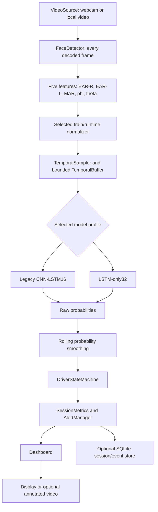

# System architecture

The application processes a local webcam or video through one shared engine. `legacy` is the default compatibility profile; `lstm32` selects the development-trained LSTM-only checkpoint and normalizer. The model produces class probabilities for Normal, Yawning, and Eye Close. The policy interprets these as engineering evidence, not a medical diagnosis.

`VideoSource` decodes and timestamps frames. The detector runs on **every decoded frame**, while the sampler targets **20 accepted face observations per source second**. A missed deadline or missing face does not cause a synthetic observation. Only accepted observations enter the sequence buffer. After readiness, each new accepted observation triggers a prediction: **runtime stride 1** for both profiles. The first candidate prediction occurs on observation 32, then on 33, 34, and so on. At 20 Hz this requires 1.60 s nominal accumulation (1.55 s between first and last samples). The legacy 16-observation window needs 0.80 s nominal accumulation.

A face gap **greater than 0.5 s** clears stale temporal observations and requires a full new warm-up. Short no-face intervals retain the sequence buffer but do not add missing entries. The decision layer holds the latest state when a decoded frame has no new accepted prediction. [State and event rules](STATE_MACHINE.md) detail the separate policy handling of missing evidence.

## Feature contract and compatibility

The model input channels are exactly **EAR-R, EAR-L, MAR, phi, theta**, in that order: right/left eye aspect ratios, mouth aspect ratio, and two head-pose angles. Each profile applies its own saved normalization transform before constructing a float32 `(batch, 5, N)` tensor. Class IDs remain `0=Normal`, `1=Yawning`, `2=Eye Close`. See [Phase 16 profile provenance](PHASE16_RUNTIME_INTEGRATION.md) for exact assets and hashes.

The learned contracts retain audit-identified legacy semantics, including the historical BGR-as-SRGB detector input and head-pose calculation quirks. These are intentionally preserved so the saved models' input meaning and frozen regression outputs remain valid. This documentation does not imply that the geometry or color semantics are corrected.

## Training windows versus runtime windows

Training stride controls overlap in an **offline dataset**. For LSTM-only32, training used `N=32, stride=16` on development-source observations. Runtime uses a rolling `N=32` buffer and **stride=1 after readiness**. It does not wait for 16 new observations between predictions. Offline training windows can include the disclosed repeat-last padding for short source videos; the live runtime never fabricates missing observations. [ML evaluation](ML_EVALUATION.md) gives the split and selection context.

## Local outputs

The dashboard reports raw/smoothed prediction, state, readiness, features, and aggregate events. Optional annotated-video output writes locally; optional `sqlite3` storage keeps session provenance, episode transitions, and final aggregates, **not raw frames or per-frame predictions**. Audio requests are local and nonblocking. See [SQLite design](PHASE10_SQLITE.md) and [privacy limitations](LIMITATIONS.md).
