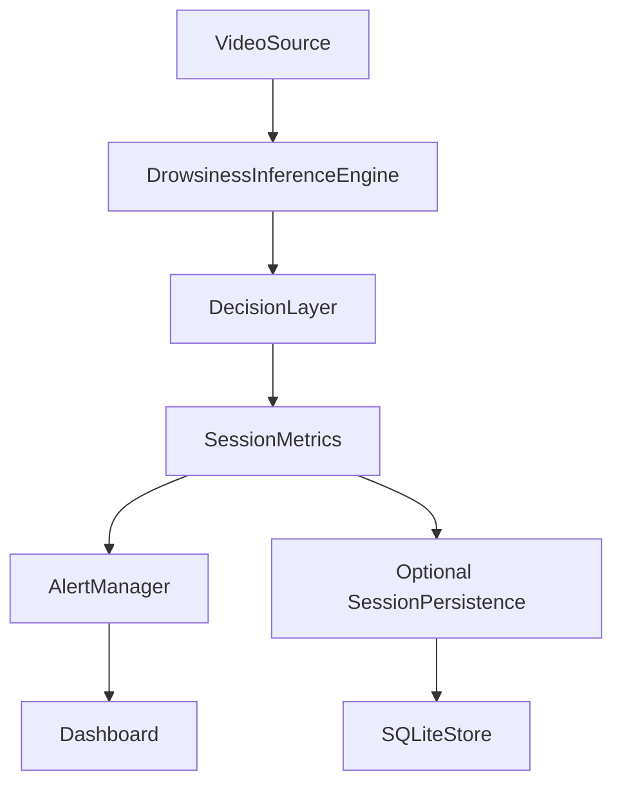
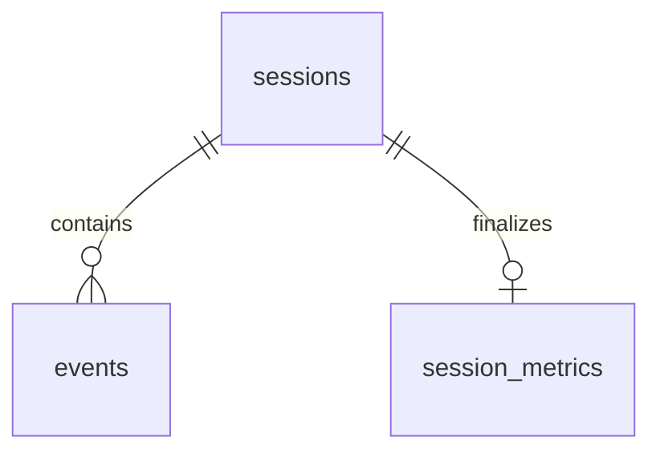

# Phase 10 — optional local SQLite persistence

**PHASE 10 PASS.** 435 tests passed, including all 380 unchanged Phase 2–9 tests and 55 Phase 10 cases. Independently replayed SQLite off/on: 699/699 raw windows and classes exact in each mode, maximum numeric difference 0.0. Stopped after Phase 10.

## 1–2. Files created and modified

Created implementation/test/tool files: `driver_monitor/storage/__init__.py`, `driver_monitor/storage/sqlite_store.py`, `driver_monitor/storage/session_persistence.py`, `tests/test_sqlite_store.py`, `tools/query_sessions.py`, `tools/validate_phase10.py`, `tools/report_phase10.py`. Created this report, `docs/phase10_before_hashes.json`, `docs/phase10_validation.json`, final/initial full-suite XML (`docs/phase10_tests.xml`, `docs/phase10_tests_initial.xml`), initial/final focused-test XML (`docs/phase10_unit_initial.xml`, `docs/phase10_unit_final.xml`), the smoke DB `results/phase10_smoke.db`, and all finite worker inputs, outputs, stderr logs, landmark archives and example databases under `results/phase10/`.

Modified only `main.py`: lazy opt-in storage startup, adapter update after analytics, atomic completion on normal exit, and two CLI flags. 2631 of 2632 prior files remain byte-identical. This includes SessionMetrics, all old tests, canonical inference/vision/model/config/assets, dashboard cache, and Phase 8/9 reports/results/benchmark evidence. Preservation hashes are in `docs/phase10_before_hashes.json` and `docs/phase10_validation.json`. Existing unrelated working-tree changes were preserved.

## 3. Storage architecture



The adapter reads each authoritative tracker immediately after metrics.update; it compares active status with its currently open row IDs. It retains at most five IDs and one last-state value. ACTIVE observations issue no SQL or transaction. It neither recomputes events nor retains episode/prediction/frame history. Analytics imports no sqlite3. Audio never accesses storage. sqlite3's default owner-thread restriction remains enabled.

## 4–8. Schema and all fields

Schema version **1**, recorded in both `PRAGMA user_version` and the single-row `schema_metadata(schema_version INTEGER PRIMARY KEY CHECK(schema_version=1), created_at_utc TEXT NOT NULL)`. Existing files are probed read-only before obtaining a writable connection. Unsupported versions, mismatched metadata/table/index definitions, foreign-key violations and failed quick_check are rejected. Existing unrelated/empty/text databases are rejected, never initialized or overwritten. There is no migration or automatic unfinished-session recovery.



sessions holds identity, wall-clock lifecycle, source-time span and provenance. events holds one row per segmented episode. session_metrics holds one final aggregate per session. schema_metadata identifies this format. There are no frame/blob/landmark/prediction tables. Source names in runtime persistence are basenames or Camera N; private absolute source/asset paths are omitted from provenance.

### sessions (plus id INTEGER PRIMARY KEY, session_uuid TEXT UNIQUE NOT NULL)

| Field | SQLite type and constraint |
|---|---|
| `source_type` | `TEXT NOT NULL CHECK(source_type IN ('file','webcam'))` |
| `source_name` | `TEXT NOT NULL` |
| `started_at_utc` | `TEXT NOT NULL` |
| `created_at_utc` | `TEXT NOT NULL` |
| `ended_at_utc` | `TEXT` |
| `source_start_seconds` | `REAL CHECK(source_start_seconds >= 0)` |
| `source_end_seconds` | `REAL CHECK(source_end_seconds >= source_start_seconds)` |
| `source_duration_seconds` | `REAL CHECK(source_duration_seconds >= 0)` |
| `checkpoint_sha256` | `TEXT` |
| `normalization_sha256` | `TEXT` |
| `face_task_sha256` | `TEXT` |
| `model_name` | `TEXT` |
| `parameter_count` | `INTEGER CHECK(parameter_count >= 0)` |
| `sequence_length` | `INTEGER CHECK(sequence_length > 0)` |
| `target_model_fps` | `REAL CHECK(target_model_fps > 0)` |
| `max_face_gap_seconds` | `REAL CHECK(max_face_gap_seconds > 0)` |
| `smoothing_mode` | `TEXT` |
| `prediction_history_size` | `INTEGER CHECK(prediction_history_size > 0)` |
| `application_version` | `TEXT` |
| `python_version` | `TEXT` |
| `torch_version` | `TEXT` |
| `opencv_version` | `TEXT` |
| `mediapipe_version` | `TEXT` |
| `runtime_config_json` | `TEXT NOT NULL` |
| `finalized` | `INTEGER NOT NULL DEFAULT 0 CHECK(finalized IN (0,1))` |
### session_metrics (plus session_id INTEGER PRIMARY KEY / FK)

| Field | SQLite type and constraint |
|---|---|
| `decoded_frames` | `INTEGER CHECK(decoded_frames >= 0)` |
| `face_detected_frames` | `INTEGER CHECK(face_detected_frames >= 0)` |
| `no_face_frames` | `INTEGER CHECK(no_face_frames >= 0)` |
| `sampled_observations` | `INTEGER CHECK(sampled_observations >= 0)` |
| `model_predictions` | `INTEGER CHECK(model_predictions >= 0)` |
| `normal_raw_count` | `INTEGER CHECK(normal_raw_count >= 0)` |
| `yawning_raw_count` | `INTEGER CHECK(yawning_raw_count >= 0)` |
| `eye_close_raw_count` | `INTEGER CHECK(eye_close_raw_count >= 0)` |
| `normal_smoothed_count` | `INTEGER CHECK(normal_smoothed_count >= 0)` |
| `yawning_smoothed_count` | `INTEGER CHECK(yawning_smoothed_count >= 0)` |
| `eye_close_smoothed_count` | `INTEGER CHECK(eye_close_smoothed_count >= 0)` |
| `state_transitions` | `INTEGER CHECK(state_transitions >= 0)` |
| `yawn_events` | `INTEGER CHECK(yawn_events >= 0)` |
| `eye_closure_events` | `INTEGER CHECK(eye_closure_events >= 0)` |
| `drowsy_events` | `INTEGER CHECK(drowsy_events >= 0)` |
| `alert_events` | `INTEGER CHECK(alert_events >= 0)` |
| `no_face_events` | `INTEGER CHECK(no_face_events >= 0)` |
| `audible_alert_requests` | `INTEGER CHECK(audible_alert_requests >= 0)` |
| `audio_suppressed_requests` | `INTEGER CHECK(audio_suppressed_requests >= 0)` |
| `audio_completed` | `INTEGER CHECK(audio_completed >= 0)` |
| `audio_failed` | `INTEGER CHECK(audio_failed >= 0)` |
| `longest_yawn_seconds` | `REAL CHECK(longest_yawn_seconds >= 0)` |
| `longest_eye_closure_seconds` | `REAL CHECK(longest_eye_closure_seconds >= 0)` |
| `longest_drowsy_seconds` | `REAL CHECK(longest_drowsy_seconds >= 0)` |
| `longest_alert_seconds` | `REAL CHECK(longest_alert_seconds >= 0)` |
| `longest_no_face_seconds` | `REAL CHECK(longest_no_face_seconds >= 0)` |
| `attentive_seconds` | `REAL CHECK(attentive_seconds >= 0)` |
| `fatigue_seconds` | `REAL CHECK(fatigue_seconds >= 0)` |
| `suspected_drowsy_seconds` | `REAL CHECK(suspected_drowsy_seconds >= 0)` |
| `drowsy_seconds` | `REAL CHECK(drowsy_seconds >= 0)` |
| `alert_seconds` | `REAL CHECK(alert_seconds >= 0)` |
| `no_face_seconds` | `REAL CHECK(no_face_seconds >= 0)` |
| `warming_up_seconds` | `REAL CHECK(warming_up_seconds >= 0)` |
| `valid_observed_decision_seconds` | `REAL CHECK(valid_observed_decision_seconds >= 0)` |
| `unobserved_interval_seconds` | `REAL CHECK(unobserved_interval_seconds >= 0)` |
| `eye_evidence_fraction` | `REAL CHECK(eye_evidence_fraction >= 0)` |
| `effective_observation_fps` | `REAL CHECK(effective_observation_fps >= 0)` |
| `offline_processing_fps` | `REAL CHECK(offline_processing_fps >= 0)` |
| `finalized_at_utc` | `TEXT NOT NULL` |
| `aggregate_json` | `TEXT NOT NULL` |

### events (all fields, keys and constraints)

```sql
CREATE TABLE events (id INTEGER PRIMARY KEY, session_id INTEGER NOT NULL REFERENCES sessions(id) ON DELETE CASCADE, event_type TEXT NOT NULL CHECK(event_type IN ('YAWN','EYE_CLOSURE','DROWSINESS','ALERT','NO_FACE')), started_at_source_seconds REAL NOT NULL CHECK(started_at_source_seconds >= 0), ended_at_source_seconds REAL CHECK(ended_at_source_seconds >= started_at_source_seconds), observed_duration_seconds REAL CHECK(observed_duration_seconds >= 0), start_state TEXT CHECK(start_state IN ('ATTENTIVE','FATIGUE','SUSPECTED_DROWSY','DROWSY','ALERT','NO_FACE','WARMING_UP')), end_state TEXT CHECK(end_state IN ('ATTENTIVE','FATIGUE','SUSPECTED_DROWSY','DROWSY','ALERT','NO_FACE','WARMING_UP')), max_confidence REAL CHECK(max_confidence BETWEEN 0 AND 1), mean_confidence REAL CHECK(mean_confidence BETWEEN 0 AND 1), audio_triggered INTEGER CHECK(audio_triggered IN (0,1)), audio_suppressed INTEGER CHECK(audio_suppressed IN (0,1)), closed_reason TEXT CHECK(closed_reason IN ('evidence_exit','temporal_reset','session_end')), CHECK((ended_at_source_seconds IS NULL AND observed_duration_seconds IS NULL AND closed_reason IS NULL) OR (ended_at_source_seconds IS NOT NULL AND observed_duration_seconds IS NOT NULL AND closed_reason IS NOT NULL)));
```

Open events have NULL end/duration/reason; closed events require all three. Start/end state indicates the policy state when the transition was observed, even when the authoritative end boundary precedes that observation. max_confidence and mean_confidence are NULL: Phase 7 does not collect per-episode confidence aggregates. audio_triggered/audio_suppressed are NULL: the tracker adapter has no authoritative per-episode playback attribution. Logical ALERT counts and final audio request/suppression/completion/failure counts are independent and retained truthfully. No fabricated confidence/audio values.

## 9–10. Referential integrity and transactions

Foreign keys are ON on every store connection. Deleting a session cascades to its events and aggregate. A partial unique index permits only one open row per session/event type; events_by_session indexes the FK. All variable values use parameter placeholders; formatted identifiers come only from fixed schema whitelists. Quotes, semicolons and Unicode source names are tested.

Session creation commits immediately. A frame with actual transitions uses one small transaction for all its START/END operations. Continued episodes perform no writes. Normal finalization atomically closes remaining events, inserts metrics, updates session timestamps/span and marks finalized=1. Any exception rolls back the entire current transaction. No per-frame commit. sqlite3 timeout is 5 seconds; default rollback journal/durability settings are retained, with no WAL/tuning/ORM/dependency.

## 11–13. Startup, completion and abnormal sessions

Requested storage initialization/write failures raise StorageError and fail the run transparently; main reports a clear error and releases engine/source/writer/windows/audio/storage resources. Startup commits a UUID session with finalized=0. EOF/q/Escape closes normal analytics events at available source observations, finishes audio, then persists final metrics. Wall-clock times are UTC ISO-8601 Z; model/event timing remains source/acquisition seconds. Offline processing FPS is the existing full loop frames/loop_seconds metric for files; webcam storage leaves it NULL.

Controlled exceptions/KeyboardInterrupt skip finalization. Prior committed START/END transitions survive, finalized=0, ended_at_utc and final metrics remain absent. Open events retain NULL duration/end because ACTIVE evidence was deliberately not written. This preserves safe completed evidence without pretending an incomplete event/session completed. Power loss/process kill cannot guarantee cleanup; SQLite's committed transaction durability applies. Opening again never rewrites unfinished sessions. Close is idempotent; context exit closes and rolls back pending work.

## 14–16. Event identity, short gaps and resets

START inserts; END updates the same ID with the tracker's end_timestamp and duration_seconds. Types: YAWN, EYE_CLOSURE, DROWSINESS, ALERT, NO_FACE. A sustained yawn is one row; separated yawns are separate rows. SUSPECTED_DROWSY→DROWSY→ALERT creates one containing eye episode, one drowsiness episode and one logical alert. ALERT's external transition semantics are unchanged: NO_FACE closes alert, and ALERT re-entry is a new alert episode.

Short NO_FACE pauses evidence bridges while retaining the containing eye/yawn/drowsiness identity. Stored observed duration excludes missing/recovery bridges, rather than subtracting end minus start. Deterministic short-gap test: eye spans 0–0.5 s, observed duration 0.2 s, same eye ID; NO_FACE duration 0.25 s.

Long reset/warm-up closes evidence at its last valid observation: deterministic eye/drowsiness end 0.1 s despite reset at 10 s. closed_reason is temporal_reset for evidence invalidation, evidence_exit for ordinary exits, session_end for normal EOF/keyboard closure. These labels describe existing tracker closures; they do not influence policy.

## 17. Provenance

Once per opt-in session: checkpoint/normalization/face-task SHA-256, CNN_LSTM name and 246595 parameters, sequence length 16, target 20 Hz, face gap 0.5 s, smoother/history, full scalar runtime/policy thresholds/durations, class mapping, compatibility flag, device/dropout, audio enable/cooldown, application format version, Python/Torch/OpenCV/MediaPipe distribution versions. Hashes are streamed once at startup, never per frame. Source video hashes are also retained in validation evidence, not required runtime DB fields. Validation workers retain default Torch 8/8 and OpenCV 12 CPU threads.

## 18–19. CLI and default-disabled behavior

```powershell
python main.py --source 0 --sqlite
python main.py --source "Eye Close/Eye Close_60.avi" --no-display --no-audio --sqlite --db-path data/drowsiness.db
python main.py --source "Normal/Normal_1.avi" --no-display --no-audio
```

--sqlite is explicitly required; --db-path alone raises a useful error before source/model loading. Enabled default path is data/drowsiness.db relative to cwd; parent directories are created. Ordinary runs never import the storage package/sqlite3, hash assets, open/create a DB or issue SQL. Only optional condition checks were added; algorithms/source-time contracts remain identical. The entire previous regression suite runs with default persistence disabled. No default database was created during validation.

## 20. Actual-video persistence results

| Source | Frames | Yawn | Eye | Drowsy | Alert | No-face |
|---|---:|---:|---:|---:|---:|---:|
| Normal/Normal_1.avi | 131 | 0 | 0 | 0 | 0 | 0 |
| Yawning/Yawning_1.avi | 135 | 1 | 0 | 0 | 0 | 0 |
| Yawning/Yawning_60.avi | 137 | 1 | 0 | 0 | 0 | 4 |
| Eye Close/Eye Close_60.avi | 141 | 0 | 1 | 1 | 1 | 0 |
| Eye Close/Eye Close_1.avi | 116 | 0 | 0 | 0 | 0 | 0 |


`results/phase10/videos.db` contains these five finalized sessions. Every normalized integer/float aggregate equals its final SessionMetrics snapshot; event counts match exactly and summed observed durations match within 1e-12 s. Supplemental aggregate_json is the exact canonical final snapshot (including source/state-frame counts and audio-disabled counts); it is bounded and contains no arrays/predictions. The same five clips are covered by fresh-process integration tests. Eye Close_1 naturally has zero eye events; no policy tuning or folder-label correction was performed.

## 21. SQL and read-only inspection

```sql
SELECT COUNT(*) FROM sessions;
SELECT event_type, COUNT(*) FROM events GROUP BY event_type;
SELECT s.id,s.source_name,m.alert_events FROM sessions s
JOIN session_metrics m ON m.session_id=s.id WHERE m.alert_events>0;
SELECT COUNT(*) FROM events WHERE event_type='YAWN';
SELECT AVG(observed_duration_seconds) FROM events WHERE event_type='DROWSINESS';
SELECT session_id,observed_duration_seconds FROM events WHERE event_type='EYE_CLOSURE'
ORDER BY observed_duration_seconds DESC LIMIT 1;
SELECT s.source_name,m.longest_eye_closure_seconds FROM sessions s
JOIN session_metrics m ON m.session_id=s.id ORDER BY m.longest_eye_closure_seconds DESC LIMIT 1;
SELECT source_type,source_name,COUNT(*) FROM sessions GROUP BY source_type,source_name;
SELECT id,source_name,started_at_utc FROM sessions WHERE finalized=0;
```

Executed total/event-type/alert/longest-eye/average-drowsy queries and exact outputs are retained in `results/phase10/validation.json`:

| Executed query | Result |
|---|---|
| total_sessions | `[[5]]` |
| events_by_type | `[["ALERT", 1], ["DROWSINESS", 1], ["EYE_CLOSURE", 1], ["NO_FACE", 4], ["YAWN", 2]]` |
| alert_sessions | `[["Eye Close_60.avi", 1]]` |
| longest_eye | `[["Eye Close_60.avi", 6.25]]` |
| average_drowsy_event_seconds | `[[5.25]]` |

Optional tool uses a read-only SQLite URI and parameterized filters, so a missing path cannot create a DB:

```powershell
python tools/query_sessions.py results/phase10/videos.db
python tools/query_sessions.py results/phase10/videos.db --session-id 4
python tools/query_sessions.py results/phase10/videos.db --session-id 4 --events
```

## 22. Storage-operation timings

| Committed operation | n | P50 ms | P95 ms | Max ms |
|---|---:|---:|---:|---:|
| session_create | 100 | 10.1128 | 11.5759 | 13.3559 |
| event_insert | 100 | 10.2578 | 12.8219 | 14.3700 |
| event_update | 100 | 9.9077 | 11.8798 | 13.0474 |
| final_metrics_write | 100 | 10.7454 | 13.0866 | 14.4649 |


100 operations of each type in one dedicated fresh worker; includes synchronous commit, no removed samples/warm-up exclusions. Final metric write includes JSON serialization, excludes schema startup, provenance hashing and final event closures. This finite synthetic API probe is separate from real-video analytics. All raw nanoseconds/distributions are in results/phase10/operations.json. SQLite 3.53.1, stdlib only, same local Windows machine/venv as Phase 9. Commits take roughly 10 ms here: actual transitions can add a visible single-frame latency spike, even though ACTIVE frames issue no SQL. Multiple same-frame transitions share one commit. No claim that enabled persistence has zero latency cost.

## 23. Optional runtime overhead (descriptive)

Eye Close_60, 141 frames, headless/audio-disabled; four sequential fresh workers in off/on/on/off order:

| Fresh-worker order | SQLite | Loop seconds | Offline FPS | Total run seconds |
|---|---|---:|---:|---:|
| 1 | off | 5.449443 | 25.874 | 14.797162 |
| 2 | on | 5.427332 | 25.980 | 13.985798 |
| 3 | on | 5.541141 | 25.446 | 13.771811 |
| 4 | off | 5.647800 | 24.965 | 13.947355 |


Median loop time off 5.548622 s, on 5.484236 s, descriptive difference -1.16%. Two observations per mode cannot isolate IO from CPU/cache/background variation or support a full-system speed/regression claim. Loop time includes transition writes and adapter checks; total time includes startup/provenance/finalization/cleanup but excludes interpreter startup/imports before main.run. Source-time policy/final metrics were exactly equal across all four runs. No Phase 9 benchmarks or its 8.6% dashboard optimization claim were regenerated or mixed with optional persistence overhead.

## 24. Database size

Five real sessions / 9 event rows / five aggregate rows: 69632 bytes (68.0 KiB) for videos.db after connection cleanup, including schema/index pages. This is one finite local example, not a scalability/storage-growth guarantee. Parity and synthetic operations use separate DBs.

## 25–27. Regression and exact parity

All 435 tests passed, zero failures/errors/skips; XML: docs/phase10_tests.xml (374.971 seconds recorded by JUnit). Phase counts: {'Phase 2': 9, 'Phase 3': 43, 'Phase 4': 53, 'Phase 5': 60, 'Phase 6': 64, 'Phase 7': 60, 'Phase 8': 27, 'Phase 9': 64, 'Phase 10': 55}. Prior test source bytes and assertions are unchanged. New tests cover schema/UTC/UUID, multiple episodes/same ID, quote safety, checks/FKs/cascade, transaction and atomic-finalization rollback (including caught inner write failure), malformed/path/permission/lock/version failures, finite source timestamps/durations, owner thread, context cleanup, unfinished reopen, 10000 ACTIVE updates with no SQL, deterministic short/long gaps, compatibility, CLI/default import isolation, EOF/q/Escape/interrupt/runtime/storage failure cleanup, read-only queries, and all five actual clips.

Fresh SQLite off/on six-source replay each matches all 699 frozen windows/classes, raw/normalized features, sequences, float32 inputs, logits and probabilities exactly (max difference 0.0). All detector x/y coordinates exposed by the runtime, complete policy/smoothing traces, final analytics snapshots and rendered pixel traces match the immutable Phase 9 production evidence and each other. Detector/engine source and task bytes are unchanged. Six landmark archives per mode plus hashes/counters are retained under results/phase10/parity_off and parity_on. Persistence-enabled final normalized metrics/counts/durations also agree with analytics.

## 28. Limitations

Local single-owner SQLite, not a multi-user backend. No migration/recovery/retention service, cloud/network/auth, raw-data storage, retraining/resplit/preprocessing/model/window/threshold changes, deployment or Phase 11 work. No live webcam/physical sound/interactive GUI repeat was claimed; q/Escape and exception flows are deterministic integration tests, videos are actual headless runs. Confidence/per-event audio attribution is intentionally NULL. File basenames can collide; UUID/id disambiguates sessions but not identically named source content. Abnormal open events contain start evidence only. Initial creation failure can leave a newly created empty/incomplete owned file requiring inspection/new filename; unrelated existing files are never truncated. File-system permission errors were injected deterministically, not measured against arbitrary ACLs. Default SQLite concurrency/durability limits apply; no arbitrary power-loss guarantee or scalability claim. Finite validation archives contain offline diagnostic landmarks, separate from runtime SQLite and bounded runtime memory.

## 29–30. Resume-safe wording and outcome

“Designed a local SQLite event/session store for timestamped fatigue, eye-closure and alert episodes, preserving aggregate driver-monitoring metrics and model provenance without storing raw frames.”

**PHASE 10 PASS. STOP after Phase 10.**

Reproduce tests with `.venv-baseline/Scripts/python.exe -B -m pytest -q`. The evidence suite uses exclusive writes; choose a new directory: `.venv-baseline/Scripts/python.exe -B tools/validate_phase10.py --suite results/phase10_new`. Do not rerun into existing evidence. Report generation asserts preservation/parity/test gates before writing new Phase 10 report/validation files.
