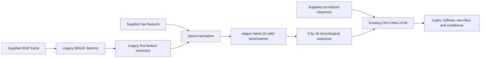

# Phase 3: reusable raw inference engine

**PHASE 3 PASS.** The full suite passed **52 tests**, including all **9 unchanged
Phase 2 tests**, with **0 failures, 0 errors, 0 skips**. The new engine matches
all **699/699** frozen prediction windows and the fresh canonical video replay.
Maximum observed differences are **0.0** at every compared numeric layer.
Phase 4 and later policies have not been implemented.

## Package and file changes

Created this package without modifying any legacy production module:

```text
driver_monitor/
    __init__.py
    config.py
    results.py
    vision/
        __init__.py
        face_detector.py
        features.py
    inference/
        __init__.py
        normalizer.py
        temporal_buffer.py
        engine.py
```

Also created:

- `tests/conftest.py`: shared read-only fixture loader and optional replay-output
  argument; existing module-local Phase 2 fixtures/tests remain intact.
- `tests/test_temporal_buffer.py`: empty/warm-up/shape/finite/order/ownership tests.
- `tests/test_engine.py`: configuration, normalization, feature/model/observation
  parity, load counts, cleanup, failure cases, memory and real-video comparison.
- `tests/test_face_detector.py`: exact color/coordinate representation, reuse of
  the legacy detector factory, no-face behavior, initialization failure and cleanup.
- `tools/compare_phase3.py`: fresh canonical-versus-engine replay and observational
  timing using exactly the Phase 2 sources, outside the frozen fixture directory.
- `docs/phase3_tests.xml`: actual complete test results and numeric measurements.
- `docs/phase3_initial_tests.xml`: earlier gate, 36 passed and 1 deselected before
  adding the remaining validation cases; superseded by the complete 52-test run.
- `docs/phase3_validation.json`: machine-readable acceptance/integrity evidence.
- `docs/phase3_replay/comparison.json`: per-layer replay differences, environment,
  package hashes, original/candidate timing summaries and measurement limitations.
- `docs/phase3_replay/engine_candidate.npz`: candidate frame/window/output/timing
  arrays; contains no duplicate full videos.
- `docs/phase3_replay/legacy/manifest.json`,
  `docs/phase3_replay/legacy/legacy_baseline.npz`,
  `docs/phase3_replay/legacy/baseline_performance.json`, and
  `docs/phase3_replay/legacy_run.log`: a fresh comparison run of the unchanged
  canonical main, distinct from the frozen Phase 2 fixture.
- `docs/PHASE3_ENGINE.md`: this report.

**Existing files modified in Phase 3: none.** In particular, all five legacy
inference scripts, `model.py`, `dataset.py`, `draw_landmarks.py`, `config.ini`,
the Phase 2 capture tool/tests/reports, dependency pins, checkpoint, mapping,
normalization and MediaPipe asset remain unchanged. The frozen
`tests/fixtures/manifest.json`, `legacy_baseline.npz`, and performance JSON were
not overwritten. Their hashes were verified before and after this phase.
The four pre-existing tracked bytecode changes were left untouched.

No top-level `inference/` package or unified `main.py` was created. The current
`inference.py` command still runs the canonical legacy loop; wiring application
sources to the new engine is a later phase.

## Engine responsibilities and API

`DrowsinessInferenceEngine` validates the baseline configuration, loads the
normalization once, constructs/loads the existing CNN-LSTM once on CPU, calls
`eval()`, initializes the unchanged detector once, and owns a bounded temporal
buffer. Prediction uses `torch.inference_mode()` and the original
`nn.Softmax(dim=1)`. Tests verify load counts and inference-mode execution.



Public entry points:

| Method | Input / behavior |
| --- | --- |
| `process_frame(frame)` | Runs detector and features, then the same normalization/buffering/inference path |
| `process_features(raw_features)` | Accepts one finite real `(5,)` vector in frozen feature order; bypasses vision only |
| `infer_sequence(sequence)` | Accepts one finite normalized `(5,16)` sequence; runs the model without changing the buffer |
| `close()` / context manager | Idempotent detector cleanup and rejection of subsequent processing |

`initialize_detector=False` allows features/sequences-only use without importing
OpenCV or MediaPipe. The default initializes the detector. Calling
`process_frame()` on an engine constructed without it raises a useful error.
This is a test/model-use entry point, not a new temporal policy.

`RuntimeConfig` resolves assets relative to the repository, or the explicitly
supplied INI's directory, rather than the process working directory. It validates
file existence, feature count 5, sequence length 16, CPU device, exactly
`{0: 'Normal', 1: 'Yawning', 2: 'Eye Close'}`, and the baseline dropout settings.
The class mapping is copied and made read-only. Existing `config.ini` is read
without modification. `Normalizer` validates `(5,2)` finite real ranges with
strictly positive maximum-minus-minimum, loads them once and never refits them.
Missing/corrupt assets and incompatible checkpoint loading have useful errors.

`ObservationResult` contains face availability, raw/normalized feature snapshots,
sequence fill, readiness and `reset_occurred=False`. Warm-up is exposed as a
property based on fill. `InferenceResult` contains the observation, sequence and
model-input snapshots, input shape, logits, probabilities, raw ID/name and
confidence. Before a prediction, those model fields are `None`. Direct sequence
inference has `observation=None` because no frame/observation was processed.

The only output class names are **Normal, Yawning, Eye Close**. There is no
derived attentive/drowsy/alert state, prediction history, smoothing, event
counter, sampling rule or alert threshold. Results are per-call snapshots;
modifying a returned vector/window does not modify the temporal buffer.

Example use without creating an application entry point:

```python
from driver_monitor import DrowsinessInferenceEngine

with DrowsinessInferenceEngine() as engine:
    result = engine.process_frame(bgr_frame)  # frame acquisition remains external
    if result.raw_class_id is not None:
        print(result.raw_class_name, result.confidence)
```

For a stored raw observation stream:

```python
with DrowsinessInferenceEngine(initialize_detector=False) as engine:
    for raw_features in supplied_observations:
        result = engine.process_features(raw_features)
```

The engine is synchronous, stateful and intended for one ordered observation
stream. It is not a shared concurrent stream processor. For independent videos,
construct independent engines so their windows do not cross source boundaries.

## Compatibility and sequence verification

Feature order is fixed to **EAR-R, EAR-L, MAR, phi, theta**. The feature layer
calls the existing EAR/MAR/head-pose functions with exactly the original landmark
index lists and extracts `phi[0]`, `theta[0]`. The detector wrapper calls the
original `dataset.get_detector()` factory once and continues to use
`detect(mp.Image(ImageFormat.SRGB, data=original_bgr_frame))`.

The following remain deliberately unchanged: normalized x/y landmark
coordinates; EAR/MAR formulas; solvePnP arguments and point order; camera matrix
assumptions; extra degree conversion; enabled blendshapes/transformation outputs;
IMAGE mode; BGR tagged SRGB; saved min/max values; scalar arithmetic with no clip
or epsilon; model architecture/weights/dropout definitions; hidden-state
initialization per window; softmax dimension and raw class semantics.

The buffer accepts only finite real `(5,)` observations. It copies each vector
into `deque(maxlen=16)`. Its window construction reproduces the original
`np.array(...).transpose(1,0)` over the current sixteen observations, without
growing full-session histories. Observations 1–15 warm up; observation 16
produces `(5,16)` and `(1,5,16)`; observations 17 and 18 produce windows 2–17 and
3–18. Normalization/window arithmetic stays float64, model input/output float32.

No-face results have `face_detected=False`, no fabricated features or prediction,
and `ready_for_inference=False` for that call. The existing buffer remains intact.
If it was already full, `warming_up=False` still describes that retained buffer;
it does not imply a prediction on the missing-face frame. No timestamps, padding,
gap reset or resampling are introduced.

The switch from no_grad to inference_mode passed a separate initial gate on all
699 frozen tensors before accepting it: both maximum logit and probability
differences were 0.0, with 699 exact raw-class matches. The final suite repeats
that check and also reconstructs all windows from the frozen raw observations.

## Memory boundedness

The actual engine's normalization and buffering paths were exercised with
**100,000 synthetic raw observations**, replacing model execution with a plain
callable solely for this memory test. No MediaPipe operation or 100,000 model
forwards were needed.

Measured/tested structural evidence:

- Maximum retained observations: **16**.
- Maximum retained feature payload: **640 bytes**, exactly 16×5×8 for float64.
- Each retained vector owns its data; it does not keep a view of a larger
  session-history allocation alive.
- Buffer remains chronological after the complete 100,000-observation stream;
  its final window matches the independently normalized final 16 observations.
- No list/dictionary session history or prediction-history attribute exists on
  the engine. Its other long-lived resources are configuration, normalizer,
  model and detector.

The payload figure excludes fixed Python/deque overhead, model/detector memory
and transient result/tensor allocations; it is not a total RAM/RSS measurement.
Callers or replay tools can retain results themselves, but the engine does not.
This is a bounded-storage correctness result, not a sustained performance claim.

## Frozen and real-video parity

The unchanged tolerance is **atol=1e-6, rtol=1e-5**. No tolerance adjustment,
fixture regeneration, corrected preprocessing or altered weights was needed.

| Layer / check | Maximum absolute difference |
| --- | ---: |
| Frozen landmarks → new feature layer, all 789 valid observations | **0.0** |
| New normalizer → frozen normalized features | **0.0** |
| New buffer → all 699 frozen chronological sequences | **0.0** |
| New float32 model inputs → frozen tensors | **0.0** |
| inference_mode model → all 699 frozen logits | **0.0** |
| Model softmax → all 699 frozen probability vectors | **0.0** |
| Fresh real-video engine → fresh canonical landmarks/features | **0.0** |
| Fresh real-video engine → fresh canonical normalization/windows/tensors | **0.0** |
| Fresh real-video engine → fresh canonical logits/probabilities | **0.0** |

Raw classes agree **699/699** in the model-only test, raw-observation replay,
candidate-versus-frozen video comparison and candidate-versus-fresh-legacy video
comparison. Shapes remain `(5,)`, `(5,16)`, `(1,5,16)`, and `(1,3)` respectively.
No-face flags, sequence fill/readiness/warm-up, frame/source identity and temporal
observation membership match exactly. Probability sums and finite logits are
checked.

The full real-video comparison uses the same six videos as Phase 2:

| Source | Frames | Valid observations | Predictions |
| --- | ---: | ---: | ---: |
| `Normal/Normal_1.avi` | 131 | 131 | 116 |
| `Normal/Normal_60.avi` | 140 | 140 | 125 |
| `Yawning/Yawning_1.avi` | 135 | 135 | 120 |
| `Yawning/Yawning_60.avi` | 137 | 126 | 111 |
| `Eye Close/Eye Close_1.avi` | 116 | 116 | 101 |
| `Eye Close/Eye Close_60.avi` | 141 | 141 | 126 |
| Total | **800** | **789** | **699** |

The unchanged Phase 2 capture tool runs actual `inference.py:main` again on
these videos. The candidate then reads the same sources; full-file and decoded
unannotated-frame hashes verify identical input bytes. The two paths both match
the frozen fixture, and are also compared directly. All 11 missing-face frames
and four short gaps reproduce baseline buffer persistence. All three raw
classes remain represented: Normal 321, Yawning 251, Eye Close 127.

## Full regression results

Command actually run:

```powershell
& .\.venv-baseline\Scripts\python.exe -B -m pytest -q --junitxml=docs/phase3_tests.xml --phase3-replay-output=docs/phase3_replay
```

Result: **52 passed in 209.49 seconds**, 0 failed/errors/skipped. The JUnit suite
time is 209.470 seconds. All 9 original Phase 2 tests passed unchanged. Evidence
is in `docs/phase3_tests.xml` and `docs/phase3_validation.json`; numerical replay
details are in `docs/phase3_replay/comparison.json`.

Tests additionally cover working-directory independence; immutable/incorrect
class mapping; invalid configuration/dimensions/device/dropout; missing model,
normalization and detector paths; invalid/nonfinite/inverted normalization
ranges; invalid NumPy archives; nonfinite/complex/malformed observations and
sequences; snapshot ownership; no-face continuity; exactly one model,
normalization and detector load per default engine; corrupt checkpoint failure
before detector initialization; context-manager cleanup on caller exception;
idempotent close and rejection of processing after close. A fresh subprocess
actively rejects OpenCV/MediaPipe imports while using the new feature/sequence
engine path. Detector-wrapper tests independently catch an accidental channel
swap or coordinate representation change.

No core parity failure was observed. The initial focused gate passed before
the final suite; further cases strengthened invalid-input and vision-wrapper
coverage, without changing valid baseline numerical behavior.

## Observational CPU timings

Same installed Phase 2 environment: Python 3.12.14, CPU PyTorch 2.14.0+cpu,
OpenCV contrib 5.0.0.93 (`cv2` 5.0.0), MediaPipe 1.0.1 and NumPy 2.5.3 on Intel
Core i5-12450H, Windows 11 10.0.26220. CUDA is unavailable; device is CPU. Defaults
remain PyTorch 8 intra-op/8 inter-op threads and OpenCV 12; no thread, detector
option, model, source resolution or sampling adjustment was made.

Sources are all 640×480, 20 FPS. As in Phase 2, discard the first **20 valid
observations per source** from steady-state statistics: 15 warm-up observations
plus 5 first predictions. There are **669** matched ready frames. Startup/model
loading, acquisition, frame hashing, overlays/GUI and encoding are excluded from
the processing boundary; acquisition is recorded separately. The candidate
boundary is a complete `process_frame()` return, including structured results.

| Stage | Frozen Phase 2 P50/P95 ms | Fresh unchanged legacy P50/P95 ms | New engine P50/P95 ms |
| --- | ---: | ---: | ---: |
| Processing | 54.249 / 62.729 | **43.750 / 51.395** | **37.991 / 45.499** |
| CNN-LSTM forward | 3.999 / 5.719 | **2.277 / 3.115** | **2.402 / 3.244** |
| MediaPipe detect | 38.279 / 42.522 | **29.361 / 36.397** | **30.106 / 37.321** |
| Feature calculations | 3.159 / 3.703 | 2.928 / 3.463 | 3.042 / 3.507 |
| Normalization | 0.064 / 0.083 | 0.060 / 0.081 | 0.055 / 0.076 |
| Acquisition/decode | 2.840 / 3.453 | 2.641 / 3.150 | 2.683 / 3.192 |

Candidate processing mean is 38.719 ms; fresh legacy mean is 44.542 ms; frozen
Phase 2 mean is 55.572 ms. Full-precision means/P50/P95 and raw timing arrays are
saved in the comparison JSON/NPZ.

These are **observational Phase 3 measurements**, not Phase 9 optimization
results. The original unchanged detector/model also ran faster than in the
historical capture, demonstrating run-to-run variability. Historical timing
differences therefore cannot be attributed to the refactor. The fresh runs are
sequential under the same recorded settings, but this is not a repeated,
randomized performance study or a background-load/clock-controlled benchmark.

The original harness is unchanged; the candidate uses corresponding core
detector/feature timers, model hooks/snapshots and engine line tracing. Different
line/copy counts and structured-result work mean observer overhead is not
identical. The candidate normalization timer also includes its input validation.
No overhead correction or speedup percentage was applied. GUI FPS, full
capture-to-display latency, independent accuracy and resume accomplishments are
not claimed. The lower processing number is recorded without claiming model or
detector acceleration; their fresh candidate medians are slightly higher.

## Remaining limitations and phase boundary

- Legacy preprocessing quirks and lack of calibration remain intentional.
  Startup/input validation rejects malformed/nonfinite data; it does not repair
  geometry, refit normalization or fabricate replacements.
- Short and long face-loss intervals retain the buffer, as required. This can
  combine observations across gaps; timestamp-aware reset remains Phase 5 work.
- No smoothing, derived states, alert thresholds, audio, UI redesign, SQLite,
  source abstraction, alternative webcam handling, resampling, retraining,
  balancing, split changes, or architecture/window experiments were added.
- `inference.py` still has its previously documented save-path and detector/
  exception-cleanup limitations. The new engine cleans up its detector, without
  redesigning legacy video capture or replacing the CLI.
- The `Eye Close_1.avi` source/model-label discrepancy from Phase 2 remains;
  matching it confirms parity, not better accuracy. No accuracy evaluation was
  performed.
- A default engine requires the repository's baseline assets. Low-level
  features/sequences-only use can omit detector initialization, but configuration
  still validates the expected asset paths.
- The replay tool accumulates candidate arrays for its fixed evaluation corpus;
  that retained test evidence is separate from the engine's bounded state.
- The tested environment is the pinned Windows x64 setup. No other platform,
  model version or dependency combination has been claimed numerically equal.

Run the full tests again with temporary comparison output:

```powershell
& .\.venv-baseline\Scripts\python.exe -B -m pytest -q
```

For a new preserved observational comparison, choose a new empty directory:

```powershell
& .\.venv-baseline\Scripts\python.exe -B tools/compare_phase3.py --output .cache/phase3-comparison-run2
```

The comparison refuses existing nonempty output and refuses the frozen fixture
directory. Existing `docs/phase3_replay` is evidence and should not be overwritten
by an ordinary rerun. Asset/source/package hashes are recorded so the measured
candidate can be tied to the tested code.

All Phase 3 acceptance gates pass. **Stop at Phase 3; the new engine has not
been wired into a Phase 4 application.**
