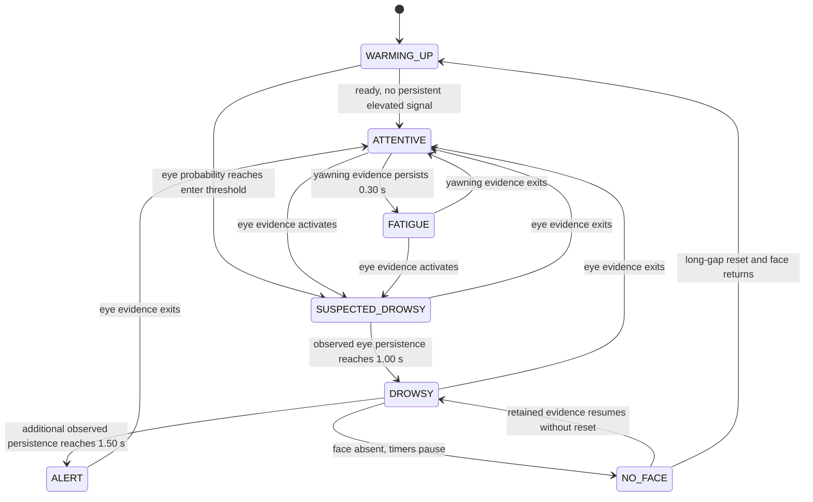

# Phase 6: smoothing and driver decision logic

**PHASE 6 PASS.** All **229 tests passed**: 9 Phase 2, 43 Phase 3, 53 Phase 4,
60 Phase 5 and 64 Phase 6; **0 failures, 0 errors, 0 skips** in
**323.175 seconds**. All old tests and assertions were run
unchanged. Frozen raw parity remains **699/699**, with maximum observed numeric
differences **0.0**. A separate six-source application characterization also
matched all 699 raw windows exactly. No Phase 7 or later work was begun.

All thresholds/history sizes below are **engineering defaults, not medically
validated**. Video results characterize model/policy behavior and stability;
they are not accuracy, false-positive, diagnostic or clinical validation.

## Files and boundaries

Created:

- `driver_monitor/inference/smoothing.py`: bounded probability evidence,
  `PredictionSmoother`, validation and `SmoothedPrediction` snapshots.
- `driver_monitor/inference/state_machine.py`: explicit `DriverState`,
  `DriverStateMachine` and `DriverStateResult` (no frames/model dependencies).
- `driver_monitor/inference/decision.py`: separate `DecisionLayer` and
  `DecisionResult`, combining one raw result with independent driver policy.
- `tests/test_smoothing.py`, `tests/test_state_machine.py`,
  `tests/test_decision_layer.py`: 64 new focused tests.
- `tools/characterize_phase6.py`: reproducible offline report diagnostics over
  all six frozen sources; not a production session/event-analytics subsystem.
- `docs/PHASE6_DECISION_LOGIC.md` (this report), `docs/phase6_tests.xml`,
  `docs/phase6_validation.json`, `docs/phase6_before_hashes.json`,
  `docs/phase6_characterization/characterization.json` and six per-source JSONs,
  `docs/phase6_cli_validation.json`, and `docs/phase6_cli_stderr.log`.
- `docs/phase6_initial_tests.xml` / `phase6_initial_tests2.xml`: passing earlier
  47/59-test development gates, superseded by the complete 229-test suite.

Modified existing files:

- `driver_monitor/config.py`: validated additive policy settings and optional
  `[policy]` INI parsing; raw `model_settings()` is unchanged.
- `main.py`: one policy update after each raw engine result, minimal raw/smooth/
  state/timer text, and two focused smoothing debug options.

All other **86 snapshotted files** were hash-verified unchanged.
In particular, engine.py, results.py, TemporalSampler/face-gap implementation,
VideoSource, feature buffer, detector, features, normalizer, model.py, saved_model.pt,
mapping/normalization/detector assets, training/legacy scripts, dependency pins,
all 165 previous tests and frozen fixtures/evidence remain intact. The frozen
config.ini was not modified. Existing tracked bytecode changes were left alone.
One-off evidence/report scripts and a saved AVI/preview live in ignored `.cache/`.

The raw `InferenceResult` remains independently usable. `DecisionResult.raw_result`
is the **same unmodified object** supplied to the layer: logits, probability
vector, confidence, ID/name, tensor, features and timing retain their semantics.
`DecisionResult.driver` is separate. No policy field replaces a raw prediction.
The application invokes the raw engine once, then the layer once, on every
decoded frame, including unsampled/no-face frames. Policy never calls the model,
changes sampling or clears the feature buffer.

## Smoothing modes and validated defaults

Default: **rolling probability average**, **history size 5**. Each valid new
model prediction contributes its complete three-class probability vector to
`deque(maxlen=history_size)`. Partial history is immediately usable; there is no
second five-prediction warm-up. Class is argmax of the mean; exact ties choose the
smallest class ID. No averaging of class IDs occurs.

Alternative: **majority vote** over per-vector argmax classes. Tied vote leaders
are ranked by averaged probability, with smallest ID resolving a final exact
tie. Returned probabilities are still the mean full vector; confidence is the
mean probability assigned to the winning voted class, not the vote fraction.
That class can differ from the mean argmax. The state machine always uses the
mean probability evidence, so changing only the voting mode can change the
displayed smoothed class without changing probability-based driver states.

Vectors must have shape (3,), real numeric values, finite components in [0,1],
and sum to one within absolute tolerance **1e-6**, accommodating float32 softmax.
They are copied; no clipping, renormalization or mutation of raw probabilities
occurs. Invalid vectors are rejected before append. Returned snapshots do not
share retained storage. The 100,000-prediction test retained at most **5 vectors**,
**120 payload bytes** (5 x 3 x float64), excluding fixed deque/object overhead.
No unbounded prediction history is present.

| Setting | Engineering default |
| --- | ---: |
| Normal positive-evidence threshold | 0.60 |
| Yawning enter / exit | 0.60 / 0.45 |
| Eye Close enter / exit | 0.70 / 0.55 |
| Yawning persistence | 0.30 seconds |
| Drowsy persistence after eye-evidence activation | 1.00 second |
| Additional persistence before logical ALERT | 1.50 seconds |

History must be an integer >=1; mode must be probability_average or majority_vote.
All thresholds are finite and within [0,1]; exits must be <= their corresponding
enters. Durations must be finite and >=0. Boolean/non-numeric values are rejected.
Zero durations intentionally permit immediate escalation/skipping intermediate
states and have explicit tests. Defaults are configurable in RuntimeConfig;
CLI supports just mode/history debugging. An optional `[policy]` section exposes
the settings when using a separately configured INI; no frozen file was edited.

These values use the user's suggested initial eye/normal/yawn confidence and
eye/alert duration candidates. Yawning's small 0.30-second persistence separates
fatigue from a single prediction; its exit band avoids obvious fatigue flapping.
They were selected as initial engineering behavior, without tuning directory
labels, event truth, medical thresholds or any claimed optimum.

## State machine and transition rules



The diagram shows the principal default path. **Every state** can transition to
NO_FACE when a face is absent; every reset with a face present goes to WARMING_UP.
NO_FACE can resume any retained active state if Phase 5 did not invalidate it.
Recovery with fresh yawning evidence passes through pending ATTENTIVE then FATIGUE
under the default 0.30-second duration. Other configured zero durations can allow
direct FATIGUE/DROWSY/ALERT transitions. No transition depends on a directory label.

- **WARMING_UP:** Phase 5 sequence has fewer than 16 accepted observations.
- **NO_FACE:** current frame lacks a face, independent of retained internal evidence.
- **ATTENTIVE:** non-escalated engineering state; strong Normal probability yields
  reason `normal_evidence`. Pending yawning or probabilities below all activation
  thresholds also use this neutral fallback with `yawning_pending` or
  `insufficient_evidence`, not a claim of confident/medically established wakefulness.
- **FATIGUE:** yawning latch remains active for at least 0.30 observed seconds;
  yawning never advances the eye timer or independently causes ALERT.
- **SUSPECTED_DROWSY:** eye evidence latch is active, below the 1.00-second timer.
- **DROWSY:** observed eye persistence reaches 1.00 second.
- **ALERT:** observed eye persistence reaches 2.50 seconds total under defaults,
  i.e. 1.50 seconds beyond DROWSY. Logical only; no sound/hardware action.

Eye evidence has priority over yawning. Entry uses `>= enter`; after activation,
the latch remains while probability is `>= exit`, including equality. A value
strictly below exit immediately clears that signal's persistence; no temporal
grace/decay is added beyond hysteresis and smoothing. Duration equality meets
the threshold, with only float roundoff tolerance `max(1e-12, 8*ulp(timestamp))`.
Near-enter 0.69/0.71 oscillation stays latched after first entry instead of flapping.

Timers accumulate source/acquisition **elapsed seconds between consecutive fresh
prediction evidence**, not prediction counts. Unsampled face-present frames hold
the current policy without advancing timers; the next real prediction can credit
the uninterrupted face-present interval. Eye/yawn activation starts at zero, so
the preceding interval from another signal is not credited. Drowsy duration is
max(0, eye persistence minus drowsy threshold), including continued ALERT
progression; it is not an eye-closure event duration or event count.

DriverStateResult includes current/previous state, transition flag/reason,
smoothed ID/name/confidence/vector, eye/yawning probabilities, separate eye/yawn
timers, drowsy duration, alert_active and current timestamp. `alert_active` is
true **only when the external state is ALERT**. Reasons distinguish warm-up,
no-face, reset, no-new-evidence holding, normal evidence, yawning pending/persistent,
eye evidence/persistence and alert persistence. There is no derived-state logic
scattered across main.py.

## No-face, reset and time semantics

Short no-face gaps preserve the smoother and internal signal timers, but expose
NO_FACE and alert_active=false. They do not append any vector, Normal, Eye Close,
or old raw result. The bridge to the previous prediction timestamp is discarded;
the first fresh prediction on return adds **zero missing-time credit**. Subsequent
valid prediction intervals resume accumulation. A return before the next sample
can display the retained active state, with timers still paused and no new raw
prediction. This is retained evidence, not a fabricated observation.

On Phase 5 `gap_reset=True`, clear smoothing and both persistence latches/timers
immediately. Current no-face state remains NO_FACE; face-present rebuilt sequence
shows WARMING_UP. No previous DROWSY/ALERT evidence survives. Warming-up after an
unexpected readiness loss also discards smoothing. Explicit DecisionLayer.reset()
clears smoother, derived state and policy clock for a disruptive stream restart;
the raw engine/source must independently follow their own restart contracts.

Timestamp validation reuses Phase 5's TemporalSampler with selection disabled,
including finite/nonnegative and strictly increasing checks. A shallow scalar
clock preview validates before modifying smoothing; the committed state-machine
clock uses the identical rule. No new timestamp fallback, wall clock or sleep
is introduced. Invalid time/vector inputs are controlled errors and leave valid
history/committed clock intact. Missing raw probabilities from legacy/testing
adapters are not fabricated into evidence. Untimed `--compatibility-mode` and
single-argument legacy adapters disable this decision layer, retaining raw
baseline functionality without inventing policy time.

The display preserves raw prediction/confidence and adds Raw, Smooth, State and
Eye-close timer lines, alongside WARMING UP, NO FACE and TEMPORAL RESET.
The actual majority-vote CLI saved **131 annotated frames at 20 FPS**, and a
decoded preview was visually inspected: all raw/smooth/state/timer text fits
the 640x480 frame. The ignored preview/output are in `.cache/phase6_output/`.
No polished dashboard, audio, SQLite or production session/event analytics was added.

## Synthetic and regression validation

The 64 new tests cover empty/single/full smoothing, vector averaging, both modes,
deterministic ties, malformed/nonfinite/out-of-range/sum-invalid vectors, ownership,
clear/reset, and 100,000-prediction bounded storage. State tests cover all seven
states, exact/below/above thresholds, hysteresis, separate yawning, timed DROWSY/
ALERT, recovery, pause/resume, reset, equality, zero durations, upstream timestamp
errors and transition reasons. Identical eye streams at 10/20/30/60 predictions/sec
reach DROWSY at 1.00 second and ALERT at 2.50 seconds, demonstrating count-independent
persistence. No real sleeps are used.

Decision tests verify raw object identity and unchanged raw arrays for all 699
frozen predictions, separate snapshots, no-face history preservation, no missing
time credit, reset/restart, disabled compatibility, one raw call/one policy update
per application frame, invalid-config startup and display separation.

| Phase | Passed | Failed / errors / skipped |
| --- | ---: | --- |
| 2 | 9 | 0 / 0 / 0 |
| 3 | 43 | 0 / 0 / 0 |
| 4 | 53 | 0 / 0 / 0 |
| 5 | 60 | 0 / 0 / 0 |
| 6 | 64 | 0 / 0 / 0 |
| Total | 229 | 0 / 0 / 0 |

Phase 2/3 raw feature, normalization, sequence, tensor, logits, probabilities
and exact class parity remain zero-difference across all 699 windows. Phase 4
source parsing/metadata/EOF/cleanup/writer/GUI/headless regressions passed. Phase 5
10/20/30/60-Hz sampling, long-gap reset/re-warm, timestamp handling, bounded storage
and sampling-enabled real-file checks passed unchanged. All previous tests were
hash-checked; no assertions or frozen fixture were changed/weakened.

## Real-video characterization

All six sources ran through actual main.run(), using one raw engine and one
decision layer per source with default probability-average settings. The observer
validated face/timestamp/fill/readiness and every raw sequence/tensor/logit/
probability/class against the frozen corpus. **699/699 raw windows matched exactly**;
every source completed at EOF. Policy defaults were fixed before this run.

Raw/smooth count order below is **Normal / Yawning / Eye Close**. Switches count
consecutive model predictions, not missing/unsampled frames. State transitions
include warm-up, no-face and resumption display transitions.

| Source | Raw counts N/Y/E | Smooth counts N/Y/E | Raw switches | Smooth switches | State transitions | Longest logical drowsy progression seconds | ALERT reached |
| --- | --- | --- | ---: | ---: | ---: | ---: | --- |
| Normal/Normal_1.avi | 103 / 12 / 1 | 111 / 5 / 0 | 14 | 4 | 1 | 0.000 | No |
| Normal/Normal_60.avi | 125 / 0 / 0 | 125 / 0 / 0 | 0 | 0 | 1 | 0.000 | No |
| Yawning/Yawning_1.avi | 0 / 120 / 0 | 0 / 120 / 0 | 0 | 0 | 2 | 0.000 | No |
| Yawning/Yawning_60.avi | 0 / 111 / 0 | 0 / 111 / 0 | 0 | 0 | 10 | 0.000 | No |
| Eye Close/Eye Close_1.avi | 93 / 8 / 0 | 101 / 0 / 0 | 16 | 0 | 1 | 0.000 | No |
| Eye Close/Eye Close_60.avi | 0 / 0 / 126 | 0 / 0 / 126 | 0 | 0 | 3 | 5.250 | Yes |

Each cell below is **decoded-frame state count / state occupancy seconds**:

| Source | WARMING_UP | NO_FACE | ATTENTIVE | FATIGUE | SUSPECTED_DROWSY | DROWSY | ALERT |
| --- | --- | --- | --- | --- | --- | --- | --- |
| Normal/Normal_1.avi | 15 / 0.750 | 0 / 0.000 | 116 / 5.750 | 0 / 0.000 | 0 / 0.000 | 0 / 0.000 | 0 / 0.000 |
| Normal/Normal_60.avi | 15 / 0.750 | 0 / 0.000 | 125 / 6.200 | 0 / 0.000 | 0 / 0.000 | 0 / 0.000 | 0 / 0.000 |
| Yawning/Yawning_1.avi | 15 / 0.750 | 0 / 0.000 | 6 / 0.300 | 114 / 5.650 | 0 / 0.000 | 0 / 0.000 | 0 / 0.000 |
| Yawning/Yawning_60.avi | 15 / 0.750 | 11 / 0.550 | 6 / 0.300 | 105 / 5.200 | 0 / 0.000 | 0 / 0.000 | 0 / 0.000 |
| Eye Close/Eye Close_1.avi | 15 / 0.750 | 0 / 0.000 | 101 / 5.000 | 0 / 0.000 | 0 / 0.000 | 0 / 0.000 | 0 / 0.000 |
| Eye Close/Eye Close_60.avi | 15 / 0.750 | 0 / 0.000 | 0 / 0.000 | 0 / 0.000 | 20 / 1.000 | 30 / 1.500 | 76 / 3.750 |

Occupancy holds the preceding frame's displayed state until the next timestamp;
the final frame has no invented terminal interval. Counts/times can therefore
describe display stability differently from persistence. No-face occupancy is
reported as NO_FACE, not credited to eye/yawn evidence. Longest logical drowsy
progression includes continued ALERT timer progression and excludes explicit
no-face pause intervals; it is not longest eye closure or an annotated clinical event.
These diagnostics exist only in the offline report observer, not as production
session/event counters.

Yawning_60 retains its four short gaps under unchanged Phase 5 rules, exposes 11
NO_FACE frames, pauses persistence and resumes FATIGUE without counting missing
time. Eye Close_60 progresses through the configured eye-persistence states and
logical ALERT. **Eye Close_1 produces 93 raw Normal, 8 Yawning and 0 Eye Close
predictions** despite its directory label; policy was not modified to force eye
closure. Its smoothed/state behavior reflects actual model evidence. That
discrepancy remains a later leakage-safe ML evaluation/retraining issue.

Raw/smooth switch numbers are stability measurements only. They do not establish
reduced false positives, accuracy improvements, medically useful drowsiness
detection, an optimal history length or optimized inference speed.

## Commands and limitations

Validated full regression and default characterization commands:

```powershell
& .\.venv-baseline\Scripts\python.exe -B -m pytest -q --junitxml=docs/phase6_tests.xml
& .\.venv-baseline\Scripts\python.exe -B tools/characterize_phase6.py --output docs/phase6_characterization
```

The characterization requires a new/empty directory and refuses frozen fixtures.
For reruns choose another output, e.g. `.cache/phase6-characterization-run2`, retaining
the current evidence. The actual majority-vote saved-output run used:

```powershell
& .\.venv-baseline\Scripts\python.exe -B main.py --source "Normal/Normal_1.avi" --no-display --smoothing-mode majority_vote --prediction-history-size 5 --output ".cache/phase6_output/normal_majority.avi"
```

Normal intended usage (physical camera unavailable in the prior smoke probe):

```powershell
& .\.venv-baseline\Scripts\python.exe -B main.py --source 0
& .\.venv-baseline\Scripts\python.exe -B main.py --source "Yawning/Yawning_1.avi" --no-display
& .\.venv-baseline\Scripts\python.exe -B main.py --source "Eye Close/Eye Close_60.avi" --no-display
& .\.venv-baseline\Scripts\python.exe -B main.py --source "Yawning/Yawning_60.avi" --no-display
& .\.venv-baseline\Scripts\python.exe -B main.py --source "Eye Close/Eye Close_1.avi" --no-display
```

Use new/nonexistent saved-output filenames for reruns. No threshold explosion in
CLI: only mode/history debugging was added; policy thresholds are centralized.

Remaining limitations: no labeled event validation or medically validated
thresholds; ATTENTIVE can be a non-alert low-evidence fallback, not proof of
wakefulness; five predictions span different durations at different model rates;
majority vote and probability mean can disagree; smooth evidence may delay
activation/recovery; short-gap persistence assumes retained evidence remains
useful and intervals between face-present predictions are continuous unless
explicit no-face/reset input breaks that assumption. The layer relies on Phase 5
to flag excessive gaps. Physical webcam/interactive GUI behavior remains
unverified; saved-output display was visually verified. Existing model/data-label,
timestamp/backend/codec and color/head-pose limitations remain unchanged. Numeric
parity is established only in the pinned tested environment.

No audio, alert hardware/thread, cooldown, yawn/eye event aggregation, longest-eye
closure metric, session summary subsystem, SQLite, retraining, alternative model,
window change or preprocessing correction was implemented. **PHASE 6 PASS.
Stop after Phase 6; Phase 7 has not begun.**
