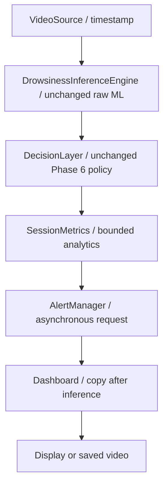

# Phase 7 — Local driver monitor

**PHASE 7 PASS.** 289 tests passed; 699/699 frozen raw predictions matched exactly. Phase 8 and later phases have not begun.

Thresholds and the 5-second audio cooldown are engineering defaults. Event metrics are not medically validated. Six-video characterization is not an accuracy evaluation. No event-level ground truth or physical audio-device validation was introduced.

## 1–3. Files and runtime architecture

Created production modules:

- `driver_monitor/metrics/__init__.py`
- `driver_monitor/metrics/session_metrics.py`
- `driver_monitor/alerts/__init__.py`
- `driver_monitor/alerts/alert_manager.py`
- `driver_monitor/ui/__init__.py`
- `driver_monitor/ui/overlay.py`

Created tests and characterization tool:

- `tests/test_session_metrics.py`
- `tests/test_alert_manager.py`
- `tests/test_overlay.py`
- `tests/test_local_monitor.py`
- `tools/characterize_phase7.py`

Modified only `main.py`: orchestrates metrics/audio/rendering, extends the aggregate RunSummary, and adds two audio CLI options. The `render_result` import preserves the existing public entry point; rendering implementation now lives in `ui/overlay.py`. No RuntimeConfig, INI, ML, detector, sampler, policy, checkpoint, preprocessing, dependency or prior test file changed.

Created this report, `phase7_validation.json`, before-change hashes, test XML, six-source characterization JSON, CLI validation/summary/log, and two dashboard PNGs. The review AVI and extra preview PNGs are under ignored `.cache/phase7_output/`; they are validation artifacts rather than application session history.



The loop acquires, infers, decides, updates metrics, requests audio, renders, then displays/writes. Rendering and playback are independent of metrics. Exactly one raw call, policy update, metrics update and audio-manager update per decoded frame. A single worker performs audio playback outside this loop.

## 4–8. Event definitions

All event trackers expose START (inactive → active; count increments), ACTIVE (same identity), and END (close). They retain current/last start, last active timestamp, end timestamp, duration, count, total observed duration and longest observed duration. No event history is retained.

| Event | START / ACTIVE | END |
|---|---|---|
| Yawn | First fresh prediction in FATIGUE; stays active in FATIGUE | Fresh valid evidence leaves FATIGUE, warm-up/reset, or finalization |
| Eye closure | First fresh SUSPECTED_DROWSY, DROWSY or ALERT evidence | Fresh valid evidence exits all three, warm-up/reset, or finalization |
| Drowsiness | First fresh DROWSY or ALERT evidence; sustained DROWSY/ALERT | Fresh valid evidence exits both, warm-up/reset, or finalization |
| Logical alert | External state enters ALERT, including return from NO_FACE | External state exits ALERT or finalization |
| No face | External state enters NO_FACE; continuous NO_FACE | Face/state recovery or finalization |

Eye progression SUSPECTED_DROWSY → DROWSY → ALERT is one eye event, one later drowsiness event, and one later ALERT event. Each continuous yawn episode counts once regardless of prediction count. A direct ALERT entry also starts its containing eye/drowsiness events (possible with zero configured persistence); definitions never redefine Phase 6 ALERT. These are engineering policy episodes, not clinical yawn-frequency measurements.

## 9–11. Missing evidence, resets and occupancy

Eye/yawn/drowsiness duration uses intervals between consecutive fresh active predictions. Only intervals with both endpoints active and no intervening NO_FACE/reset are added. Recovery ends at the last active evidence timestamp; a recovery prediction does not certify the preceding interval. Unsampled frames neither duplicate predictions nor advance evidence-duration endpoints. This conservative rule follows Phase 6 persistence and can differ from display occupancy.

Short NO_FACE preserves eye/yawn/drowsiness identity, clears the duration bridge, and keeps missing time out of those durations. The first returning fresh prediction re-establishes a bridge with zero duration addition; subsequent active evidence adds time again. ALERT episodes follow external state literally: NO_FACE ends the ALERT episode, and returning ALERT creates another logical episode subject independently to audio cooldown.

On `gap_reset=True`, open eye/yawn/drowsiness events close at their last valid active evidence timestamp, never at the later reset time. Warm-up also closes evidence episodes. No-face intervals remain separate and can span a reset while the face is still unavailable.

State occupancy assigns each decoded-timestamp delta to the previous displayed state, with no final interval invented. For a reset bridging a previous face state and a source stall, the bridge is recorded in `unobserved_interval_seconds`, not assigned to attentive/drowsy occupancy. If the previous state was already NO_FACE, its held interval stays NO_FACE. Normal six-source occupancy is exactly unchanged from Phase 6.

No-face duration holds NO_FACE from its first unavailable frame until the returning frame; at EOF it ends at the last available timestamp. This deliberately differs from conservative eye/yawn endpoint durations. Occupancy + explicitly unobserved reset bridges equals session timestamp span in timed production runs.

## 12–13. Aggregate fields and boundedness

SessionMetrics snapshots contain start/end timestamp, duration, finalized flag; decoded/face/no-face frame counts; sampled observations and predictions; three raw and three smoothed prediction counters; seven state duration and frame-count entries; transition count; five event tracker snapshots; valid observed decision seconds; unobserved reset-bridge seconds; face-state occupancy duration; Eye-Evidence Fraction; effective model observation FPS; and an optional bounded audio snapshot.

Smoothed counts increment only on new raw predictions, not held display frames. Face-state occupancy includes face-visible warm-up; it is not an attentive-time claim. Eye-Evidence Fraction is observed eye-event seconds / valid observed decision seconds, excluding explicit missing-face bridges. It is not PERCLOS. Legacy untimed compatibility mode has raw counts but no fabricated policy state/events.

Storage is five slotted event trackers, fixed class/state dictionaries and scalar counters/timestamps. No frames, vectors, predictions or per-event history are retained. Snapshot dictionaries are caller-owned; reset creates a fresh session/epoch. Finalize is idempotent, closes open events at known timestamps and rejects subsequent updates until reset.

The 100,000-update test showed a net retained-allocation change of -4 traced bytes after its 1,000-update warm-up; peak traced allocation was 3356 bytes. Tracker identities stay fixed and serialized aggregate size remains under 6 KB. Scalar integer counters grow logarithmically with count; no list growth occurs.

## 14–17. Audio manager, backend and cooldown

AlertManager owns one lazy worker thread, a Condition, at most one pending request, and scalar status/counters. The inference thread never calls playback or waits for playback completion. The Windows standard-library backend calls `winsound.Beep(1200, 300)` only on the worker. No new dependency was added. On other platforms an enabled backend records an explicit Windows-backend error; `--no-audio` disables it.

Audio requests occur only on ALERT entry. Continued ALERT frames never restart sound. Default `ALERT_COOLDOWN_SECONDS = 5.0`, configurable through `--alert-cooldown-seconds`; elapsed cooldown is based on the same source timestamp clock as policy. An entry before cooldown expiry, or while a request/playback is pending, is suppressed without suppressing the logical ALERT event. Exact equality at cooldown permits a new request if the worker is idle. Disabled requests are counted separately.

Bounded status: enabled, currently playing, pending, closed, last trigger timestamp, accepted audible trigger count, suppressed count, disabled count, completed playback count, failed playback count, cooldown remaining and last error (maximum 500 characters). Audible trigger count means an accepted playback request; it does not certify that a person heard a sound. Playback success/failure is exposed separately.

Worker/backend failures are recorded without affecting inference or logical ALERT. A real 141-frame Eye Close_60 application run with an injected audio-device failure completed at EOF with one logical alert, one accepted audio request, zero successful playback completions, one failure and the recorded error. Unit tests inject all backends and use Events/Conditions rather than sleep or actual sound.

close() is idempotent, drains an accepted request, signals shutdown and joins the worker. The default beep is bounded to 300 ms; shutdown joins for at most 2 seconds. An arbitrary custom backend that never returns cannot be forcibly killed by Python: a shutdown-timeout error is recorded and its daemon thread cannot block process exit. Tests verify clean shutdown/no live worker leaks for supported returning backends.

## 18–21. Dashboard, saved output and headless behavior

Dark OpenCV dashboard: title, wide state banner with a colored stripe and explicit state text, aspect-preserving video pane on the left, raw/smoothed diagnostics and sequence/cadence on the right, then features, event counters and session metrics below. ALERT uses a prominent red banner; fatigue/suspected/drowsy states use progressively warmer warning accents. State text supplies meaning independently of color.

Displays raw prediction/confidence (or held/unavailable), smoothed class/confidence, derived state, sequence fill, source nominal FPS, target observations/sec, current observation FPS, eye-evidence timer, source/frame, EAR-R/EAR-L/MAR, Pose phi/Pose theta, yawn/eye/drowsy/alert counts, session elapsed time, audible requests and Eye-Evidence Fraction. OpenCV Hershey fonts use ASCII phi/theta labels; these are legacy model features, not calibrated yaw/pitch. No inference latency is invented. Throughput remains separately named in the JSON summary.

WARMING UP, NO FACE, NOT SAMPLED and TEMPORAL RESET remain explicit. Long text scales to its allocated width. Rendering works on a same-size copy after inference and never changes detector input. Tests cover every state, all essential text bounds at 640×480, larger/smaller output dimensions and long source labels; tiny inputs preserve dimensions but cannot promise human readability.

Saved annotated Eye Close_60 AVI reopened successfully: **141 decoded frames, 640×480, 20.0 nominal FPS**. Warm-up, SUSPECTED_DROWSY, DROWSY and ALERT frames were visually inspected; no essential text was clipped. The previous safe paths, input/output inequality, no overwrite, metadata fallback and cleanup tests passed unchanged.


`--no-display` performs all analytics and produces the final JSON aggregate without requiring rendering/GUI. Headless operation defaults to silent audio; `--no-audio` also disables audio during displayed runs. Normal displayed runs enable local audio by default. Saved video still renders the dashboard in headless mode. EOF and q/Escape runs finalize aggregates; fatal processing errors/Ctrl+C preserve prior cleanup/error exit behavior and do not emit a normal-success summary.

The existing RunSummary fields remain intact; `session_metrics` adds the bounded structured aggregate to stdout. No optional summary-file CLI or automatic session-file writer was added. Characterization writes only explicitly requested report aggregates. No SQLite, database, persistent user-session history, event history, retraining or optimization was implemented.

## 22–24. Six-video characterization

Fixed Phase 6 defaults: probability average, H=5, normal threshold .60; yawn enter/exit .60/.45 with .30 s persistence; eye enter/exit .70/.55 with 1.0 s to DROWSY and another 1.5 s to ALERT. Target observation cadence remains 20 Hz; face-gap threshold remains .5 s. No source-label tuning. Real audio disabled on every automated characterization run.

Counts below are raw/smoothed **predictions** in Normal / Yawning / Eye Close order, followed separately by event counts.

| Source | Frames / face | Raw N/Y/E | Smooth N/Y/E | Yawn / eye / drowsy / alert events | No-face intervals | Audible / suppressed |
|---|---:|---|---|---|---:|---|
| Normal/Normal_1.avi | 131 / 131 | 103/12/1 | 111/5/0 | 0/0/0/0 | 0 | 0 / 0 |
| Normal/Normal_60.avi | 140 / 140 | 125/0/0 | 125/0/0 | 0/0/0/0 | 0 | 0 / 0 |
| Yawning/Yawning_1.avi | 135 / 135 | 0/120/0 | 0/120/0 | 1/0/0/0 | 0 | 0 / 0 |
| Yawning/Yawning_60.avi | 137 / 126 | 0/111/0 | 0/111/0 | 1/0/0/0 | 4 | 0 / 0 |
| Eye Close/Eye Close_1.avi | 116 / 116 | 93/8/0 | 101/0/0 | 0/0/0/0 | 0 | 0 / 0 |
| Eye Close/Eye Close_60.avi | 141 / 141 | 0/0/126 | 0/0/126 | 0/1/1/1 | 0 | 0 / 0 |

| Source | Longest yawn (s) | Longest eye (s) | Longest drowsy progression (s) | Longest alert (s) | No-face total / longest (s) |
|---|---:|---:|---:|---:|---|
| Normal/Normal_1.avi | 0.00 | 0.00 | 0.00 | 0.00 | 0.00 / 0.00 |
| Normal/Normal_60.avi | 0.00 | 0.00 | 0.00 | 0.00 | 0.00 / 0.00 |
| Yawning/Yawning_1.avi | 5.65 | 0.00 | 0.00 | 0.00 | 0.00 / 0.00 |
| Yawning/Yawning_60.avi | 5.00 | 0.00 | 0.00 | 0.00 | 0.55 / 0.30 |
| Eye Close/Eye Close_1.avi | 0.00 | 0.00 | 0.00 | 0.00 | 0.00 / 0.00 |
| Eye Close/Eye Close_60.avi | 0.00 | 6.25 | 5.25 | 3.75 | 0.00 / 0.00 |

State occupancy seconds (all omitted states = 0):

| Source | Occupancy |
|---|---|
| Normal/Normal_1.avi | WARMING_UP 0.75, ATTENTIVE 5.75 |
| Normal/Normal_60.avi | WARMING_UP 0.75, ATTENTIVE 6.20 |
| Yawning/Yawning_1.avi | WARMING_UP 0.75, ATTENTIVE 0.30, FATIGUE 5.65 |
| Yawning/Yawning_60.avi | WARMING_UP 0.75, NO_FACE 0.55, ATTENTIVE 0.30, FATIGUE 5.20 |
| Eye Close/Eye Close_1.avi | WARMING_UP 0.75, ATTENTIVE 5.00 |
| Eye Close/Eye Close_60.avi | WARMING_UP 0.75, SUSPECTED_DROWSY 1.00, DROWSY 1.50, ALERT 3.75 |

Yawning_60 has one yawn identity across four short NO_FACE intervals: 5.00 s observed yawn evidence versus 5.20 s FATIGUE display occupancy. Missing intervals and their entry/recovery bridges never inflate yawn evidence. Eye Close_60 has one 6.25 s eye event, a 5.25 s drowsy progression and a 3.75 s logical alert episode. Eye Close_1 remains mostly raw Normal with smoothed Normal and zero eye/drowsy/alert events. Folder names never override actual model evidence.

Audible requests are 0 for all six silent runs. Eye Close_60 records one disabled audio-entry request, independently of its one logical alert episode. Cooldown and backend-success behavior are tested with mocks; no audible hardware playback was performed.

## 25–27. Full suite, regressions and raw parity

**289 passed, 0 failed, 0 errors, 0 skipped** in 204.803 seconds. Prior assertions were neither edited nor weakened.

| Phase | Passed tests |
|---|---:|
| Phase 2 | 9 |
| Phase 3 | 43 |
| Phase 4 | 53 |
| Phase 5 | 60 |
| Phase 6 | 64 |
| Phase 7 | 60 |

Real six-source replay verifies timestamps, face availability, sampled flags, sequence fill, raw features, normalized features, every sequence/tensor/logit/probability and class ID against frozen Phase 2 data: **699/699 raw windows, maximum numeric difference 0.0**. A new additional 699-window ownership test consumes raw outputs through policy, metrics and disabled audio and confirms arrays remain exact. Existing Phase 2–6 regression tests and fixture tolerances remain unchanged.

SHA-256 verification confirms 104 pre-existing files preserved; only main.py changed. This includes all prior tests, policy, temporal/raw layers, checkpoint, normalization/class/face assets and prior evidence reports. Snapshot and tested source digests are in `phase7_validation.json`.

## 28. Remaining limitations

- Engineering thresholds/events are not medically validated; no event precision/recall, accuracy or false-positive claims are made.
- ATTENTIVE includes the Phase 6 neutral low-evidence fallback; it does not establish wakefulness. Model limitations on Eye Close_1 remain visible.
- Evidence durations conservatively omit entry/recovery bridges around missing frames and the last-to-recovery interval. Display occupancy uses a separate previous-state-hold convention.
- ALERT episodes may split on short NO_FACE while their containing eye/drowsiness event identity persists; cooldown prevents repeated audio requests within its interval.
- Audio request counts do not prove playback/hearing. Physical audio hardware and webcam GUI use were not tested; the prior unavailable camera probe is not reclassified as a success.
- Non-Windows platforms require disabled audio or an injected backend. Non-returning custom backends can outlive the bounded shutdown timeout.
- 640×480 layout was visually checked. Very small frames preserve dimensions but are not readable dashboards.
- No performance improvements are claimed. Detector mode, preprocessing, source resolution, model/thread settings and raw inference remain untouched.

## 29. Exact commands

Run from the repository root in PowerShell with the existing baseline environment:

```powershell
# Displayed webcam; local audio enabled by default
& .\.venv-baseline\Scripts\python.exe -B main.py --source 0
# Displayed file with audio disabled
& .\.venv-baseline\Scripts\python.exe -B main.py --source "Eye Close/Eye Close_60.avi" --no-audio
# Headless annotated file; choose a NEW output path
& .\.venv-baseline\Scripts\python.exe -B main.py --source "Eye Close/Eye Close_60.avi" --no-display --no-audio --output .cache/phase7_output/eye_close_dashboard.avi
# Audio engineering cooldown override
& .\.venv-baseline\Scripts\python.exe -B main.py --source 0 --alert-cooldown-seconds 5
# Six-source characterization; choose a NEW or EMPTY output directory
& .\.venv-baseline\Scripts\python.exe -B tools/characterize_phase7.py --output docs/phase7_characterization
# Full Phase 2–7 suite, with all injected/silent test audio
& .\.venv-baseline\Scripts\python.exe -B -m pytest -q --junitxml=docs/phase7_tests.xml
# One-off saved AVI / injected failure verification (new AVI path required)
& .\.venv-baseline\Scripts\python.exe -B .cache/verify_phase7_runtime.py
```

Production output/characterization refuse existing destinations; reruns require new filenames/directories. No summary file is written automatically. Stdout contains only the final aggregate JSON on successful CLI completion.

## 30. Decision

**PHASE 7 PASS.** All requested acceptance criteria are satisfied with bounded in-memory analytics, separate nonblocking audio, dashboard/saved-output validation, silent characterization, unchanged Phase 6 policy and exact raw parity. Stopped at Phase 7. No Phase 8/9/10 work, database persistence, retraining, benchmarking optimization or alternative-model experiments were started.
