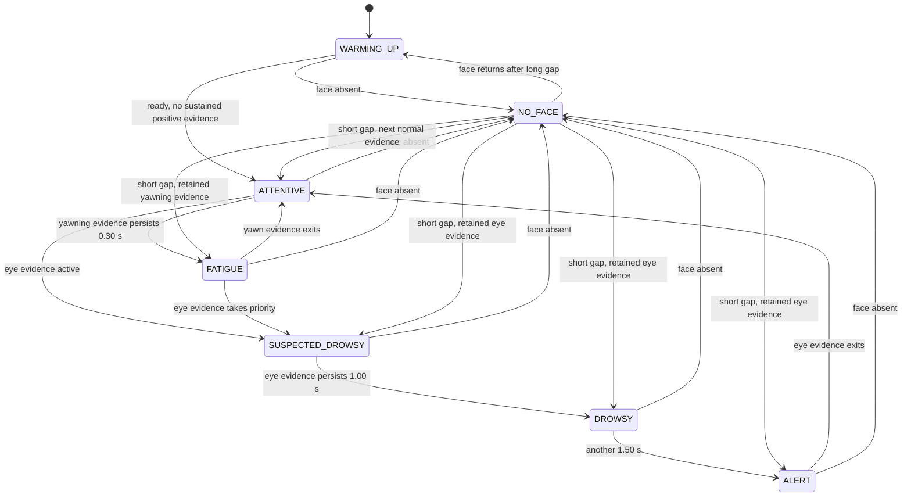

# State machine and event semantics

The policy consumes the rolling average of up to **five prediction probability vectors**. The history starts only after a model has enough accepted observations. These thresholds are **engineering defaults retained from the frozen runtime policy**, not medically or clinically validated thresholds.

The diagram shows common paths; the next valid probability vector and retained timers determine the exact return state. `WARMING_UP` means no usable model prediction yet, including after a long face-gap reset. `NO_FACE` describes a decoded frame without a detected face. `ATTENTIVE` is the neutral/non-alert state and can also mean insufficient positive evidence; it is not proof of attentiveness. `FATIGUE` follows sustained yawning evidence. Eye evidence first yields `SUSPECTED_DROWSY`, then `DROWSY`, then logical `ALERT`.

| Policy value | Frozen default |
|---|---:|
| Normal positive-evidence threshold | 0.60 |
| Yawn enter / exit | 0.60 / 0.45 |
| Eye Close enter / exit | 0.70 / 0.55 |
| Yawn persistence | 0.30 s |
| Eye persistence to DROWSY | 1.00 s |
| Additional eye persistence to ALERT | 1.50 s (2.50 s total) |

Hysteresis means an active yawn/eye signal stays active until its lower exit threshold fails. Eye evidence takes priority over yawn evidence. Timers advance on valid new decisions using source timestamps; missing-face time is not counted as evidence. A long face gap clears smoothing, persistence, and the temporal buffer. A short gap displays `NO_FACE`, pauses event duration accounting, and can preserve eye/yawn/drowsiness episode identity if evidence resumes; no missing interval is added to observed duration.

## Events and episode identity

`SessionMetrics` tracks five event kinds with start, last active time, observed duration, count, and longest/total duration. These are logical policy episodes, not hand-labeled event detections.

| Event | Opens while | Short `NO_FACE` behavior |
|---|---|---|
| `YAWN` | `FATIGUE` | Paused; may resume the same episode |
| `EYE_CLOSURE` | `SUSPECTED_DROWSY`, `DROWSY`, or `ALERT` | Paused; may resume the same episode |
| `DROWSINESS` | `DROWSY` or `ALERT` | Paused; may resume the same episode |
| `ALERT` | Logical state `ALERT` | **Closes on `NO_FACE`; a return creates a new episode** |
| `NO_FACE` | State `NO_FACE` | Counts the continuous missing-face interval and closes at recovery |

`ALERT` follows external-state transitions, even if underlying eye evidence remains active across a short gap. It must not be described as one continuous ALERT episode through `NO_FACE`. An optional audio manager may request a local warning for ALERT; audio requests are separate from logical ALERT event counts. The [Phase 6 policy record](PHASE6_DECISION_LOGIC.md), [Phase 7 monitor record](PHASE7_LOCAL_MONITOR.md), and [Phase 10 storage record](PHASE10_SQLITE.md) contain test-level details.
